# SentinelX — Security Operations Center (SOC) Monitoring Dashboard
## Academic Project Report and Software Engineering Documentation

---

### Project Metadata and Submission Details

| Field | Academic Project Specification |
| :--- | :--- |
| **Project Title** | SentinelX — Full-Stack SOC Monitoring Dashboard |
| **Project Subtitle** | A SIEM-Inspired Telemetry Visualization and Incident Management Platform |
| **Student Name** | *[Insert Student Full Name]* |
| **Registration / Student ID** | *[Insert Registration / Roll Number]* |
| **Degree Program** | Bachelor of Technology / Bachelor of Science in Computer Science & Engineering |
| **Department** | Department of Computer Science and Engineering |
| **Institution** | *[Insert College / University Name]* |
| **Project Supervisor / Guide**| *[Insert Supervisor Name and Academic Designation]* |
| **Academic Session / Year** | 2026 – 2027 |
| **Date of Submission** | *[Insert Submission Date]* |

---

## Abstract

Modern enterprise environments generate vast volumes of heterogeneous event telemetry, making centralized visibility and rapid incident response critical to cybersecurity defense. Security Operations Centers (SOCs) rely heavily on Security Information and Event Management (SIEM) platforms to consolidate log streams, identify abnormal behaviors, and coordinate incident triage. However, full-scale commercial SIEMs present high financial and infrastructure overhead, creating a need for educational and architectural prototypes that illustrate the core software engineering principles governing security telemetry visualization, incident lifecycle tracking, and analyst workflow management.

This project presents **SentinelX**, an intermediate-level, full-stack SOC monitoring dashboard prototype. SentinelX implements a decoupled, client-server web architecture designed to simulate and manage core security monitoring workflows. The frontend is built using **React 18**, **TypeScript**, and **Vite**, styled with **Tailwind CSS**, and visualizes threat data using **Recharts**. The backend is developed as a modular REST API using **Node.js**, **Express.js**, and **TypeScript**, interacting with a **PostgreSQL** relational database through **Prisma ORM** via the modern `@prisma/adapter-pg` driver adapter. 

The platform provides an executive security overview with dynamic key performance indicators, a 7-day activity timeline, an interactive severity distribution chart, a real-time security events log explorer with client-side multi-parameter filtering, an incident management system supporting inline lifecycle updates and analyst assignment, threat analytics, and an analyst account registry with bcrypt-hashed credentials. 

While the system successfully demonstrates compile-time type safety, structured layered architecture, and live data aggregation from database records, it represents an exploratory prototype rather than a production SIEM. Current prototype limitations include the absence of a dynamic rule-based detection engine, the lack of an authentication and access-control gateway, read-only frontend alert views, desktop-centric layout constraints, and absence of foreign-key constraints across database models. This report documents the complete requirements, architectural design, database modeling, implementation details, testing verification, cybersecurity evaluation, limitations, and future enhancements of SentinelX.

---

## Table of Contents

1. [Introduction](#1-introduction)
   - 1.1 Background of Cybersecurity Operations
   - 1.2 The Role of Security Operations Centers (SOC)
   - 1.3 Importance of Centralized Security Monitoring
   - 1.4 Motivation Behind SentinelX
2. [Problem Statement](#2-problem-statement)
   - 2.1 Challenges in Modern Threat Visibility
   - 2.2 Operational Friction in Incident Management
   - 2.3 Need for an Accessible Prototype Platform
3. [Project Objectives](#3-project-objectives)
   - 3.1 Primary Implemented Objectives
   - 3.2 Secondary and Architectural Objectives
   - 3.3 Future Roadmap Objectives
4. [Existing Systems vs. Proposed System](#4-existing-systems-vs-proposed-system)
   - 4.1 Analysis of Existing Industry Solutions
   - 4.2 Limitations of Traditional Approaches
   - 4.3 The SentinelX Approach
   - 4.4 Comparative Analysis Table
5. [Scope of the Project](#5-scope-of-the-project)
   - 5.1 Functional Scope
   - 5.2 Technical and Architectural Scope
   - 5.3 Target SOC Use Cases
   - 5.4 Explicitly Out-of-Scope Items
6. [Requirements Analysis](#6-requirements-analysis)
   - 6.1 Functional Requirements
   - 6.2 Non-Functional Requirements
   - 6.3 Hardware Environment Requirements
   - 6.4 Software Environment Requirements
7. [Technology Stack and Engineering Rationale](#7-technology-stack-and-engineering-rationale)
   - 7.1 Frontend Technologies
   - 7.2 Backend Technologies
   - 7.3 Database and ORM Layer
   - 7.4 Development, Tooling, and Version Control
8. [System Architecture and Design](#8-system-architecture-and-design)
   - 8.1 Architectural Paradigm (Decoupled Client-Server)
   - 8.2 Frontend Architecture
   - 8.3 Backend Layered Architecture
   - 8.4 REST API Communication Model
   - 8.5 Database Interaction and Data Flow
   - 8.6 System Architecture Diagram
9. [Database Design and Data Modeling](#9-database-design-and-data-modeling)
   - 9.1 Data Modeling Strategy
   - 9.2 Entity Specifications and Schemas
   - 9.3 Database Constraints and Indexing Analysis
   - 9.4 Architectural Absence of Foreign-Key Relationships
   - 9.5 Entity-Relationship (ER) Diagram
10. [System Implementation](#10-system-implementation)
    - 10.1 Security Overview Dashboard
    - 10.2 Security Alerts Management Module
    - 10.3 Incident Management and Investigation Module
    - 10.4 Security Event Log Explorer
    - 10.5 Threat Analytics Module
    - 10.6 Analyst and User Management Module
    - 10.7 Navigation and Persistent Notification Center
    - 10.8 Backend API and Database Service Integration
11. [REST API Design and Endpoint Documentation](#11-rest-api-design-and-endpoint-documentation)
    - 11.1 Architectural Principles
    - 11.2 Endpoints Specification Table
    - 11.3 Request Lifecycle and Controller Flow
    - 11.4 Error Handling and Response Inconsistencies
12. [Cybersecurity Evaluation and Security Considerations](#12-cybersecurity-evaluation-and-security-considerations)
    - 12.1 Implemented Security Controls
    - 12.2 CORS Policy and Browser Boundary Analysis
    - 12.3 SQL Injection Defenses and Parameterized Query Limitations
    - 12.4 Password Storage Security
    - 12.5 Critical Security Gaps and Threat Analysis
13. [Testing, Build Verification, and Quality Assurance](#13-testing-build-verification-and-quality-assurance)
    - 13.1 Compile-Time TypeScript Verification
    - 13.2 Production Bundle Build Verification
    - 13.3 Distinction Between Build Verification and Runtime Testing
    - 13.4 Verification Gaps and Unverified Runtime Behaviors
14. [Results and Technical Discussion](#14-results-and-technical-discussion)
    - 14.1 Functional Outcomes
    - 14.2 Support for SOC Analyst Workflows
    - 14.3 Software Engineering Challenges and Decisions
    - 14.4 Critique of the Prototype Nature
15. [System Limitations and Known Technical Debt](#15-system-limitations-and-known-technical-debt)
    - 15.1 Architectural and Security Limitations
    - 15.2 Functional and User Interface Limitations
    - 15.3 Scalability and Performance Limitations
16. [Future Enhancements and Project Roadmap](#16-future-enhancements-and-project-roadmap)
    - 16.1 Security and Identity Enhancements
    - 16.2 Detection Engine and Event Generation Simulation
    - 16.3 Relational Schema Normalization and MITRE Mapping
    - 16.4 Performance, Pagination, and Testing Frameworks
17. [Conclusion](#17-conclusion)
    - 17.1 Summary of Contributions
    - 17.2 Evaluation of Objective Fulfillment
    - 17.3 Academic and Educational Value
18. [References](#18-references)

---

## 1. Introduction

### 1.1 Background of Cybersecurity Operations
Contemporary enterprise computer networks are subject to constant probing, reconnaissance, and sophisticated cyberattacks by malicious threat actors. Organizations operate distributed digital estates composed of cloud instances, virtualization servers, endpoint workstations, network gateways, database clusters, and web services. Each of these assets generates log data reflecting operational and security states—ranging from normal user authentications to anomalous lateral movements, unauthorized privilege escalations, and bulk data exfiltration attempts.

Without structured collection and analysis, raw log telemetry remains an unmanageable liability. Cybersecurity operations have consequently evolved from reactive manual reviews into continuous, structured defense practices designed to ingest, normalize, analyze, and remediate security events before operational disruptions occur.

### 1.2 The Role of Security Operations Centers (SOC)
A Security Operations Center (SOC) is a centralized organizational unit responsible for monitoring, assessing, and defending an enterprise's digital infrastructure. Operating under defined procedural frameworks (such as NIST SP 800-61 Rev. 2 or ISO/IEC 27035), a SOC functions through tiered analyst responsibilities:
- **Tier 1 (Triage Specialists):** Continuously monitor event logs and security alerts, filter out false positives, validate legitimate anomalies, and escalate suspicious activities.
- **Tier 2 (Incident Handlers & Responders):** Perform deep forensic investigations into confirmed security breaches, assess blast radiuses, contain impacted systems, and coordinate remediation.
- **Tier 3 (Threat Hunters & Senior Specialists):** Actively search for stealthy, advanced persistent threats (APTs) that bypass automated controls, conduct malware analysis, and refine detection logic.

To operate effectively, all tiers depend on centralized software dashboards that aggregate telemetry, present situational awareness, track incident states, and maintain accountability.

### 1.3 Importance of Centralized Security Monitoring
Security Information and Event Management (SIEM) systems represent the foundational technology of modern SOCs. Centralized security monitoring provides three essential operational capabilities:
1. **Situational Awareness:** A unified dashboard surfaces real-time metrics, incident queues, and system health status across dispersed endpoints.
2. **Contextual Correlation:** Isolated events (such as five consecutive failed logins followed by a successful login from a foreign subnet) become actionable alerts when analyzed collectively.
3. **Structured Investigation Lifecycles:** Incidents require formal tracking from detection through triage, containment, resolution, and post-incident review, ensuring compliance and operational integrity.

### 1.4 Motivation Behind SentinelX
While commercial platforms such as Splunk Enterprise Security, Microsoft Sentinel, and IBM QRadar offer enterprise-grade capabilities, their complexity, closed-source architectures, and extensive infrastructure prerequisites obscure the underlying software engineering mechanisms for students and aspiring cybersecurity developers.

**SentinelX** was conceptualized and developed as an academic and portfolio project to bridge this educational gap. The core motivation is to construct an accessible, transparent, and modular full-stack web application that models the essential components of a SOC environment:
- Telemetry display through real-time charts and event logs.
- Security alert classification and unresolved tracking.
- An interactive incident investigation workflow.
- Analyst role assignment and administrative management.
- Complete architectural separation of frontend UI, RESTful API controllers, business services, and database persistence.

---

## 2. Problem Statement

### 2.1 Challenges in Modern Threat Visibility
In fragmented network environments, system administrators frequently inspect server logs in silos via command-line utilities (such as `journalctl`, Windows Event Viewer, or localized log files). This decentralized approach suffers from severe limitations:
- **Lack of Global Context:** A distributed port scan targeting twenty distinct internal servers appears as minor, isolated connection attempts on individual machines.
- **Alert Fatigue:** Analysts become overwhelmed by raw log volumes, missing critical indicators of compromise (IoCs).
- **Delayed Mean Time to Detect (MTTD):** Without automated aggregation, security breaches often go unnoticed for weeks or months.

### 2.2 Operational Friction in Incident Management
Even when threats are detected, disorganized incident handling undermines response effectiveness:
- Security teams frequently track incidents through informal mechanisms (spreadsheets, chat channels, or email chains), resulting in unassigned tickets, duplicated investigation efforts, and lost audit trails.
- Status lifecycles (`open`, `investigating`, `contained`, `resolved`, `closed`) are inconsistently enforced, impairing organizational accountability and compliance reporting.

### 2.3 Need for an Accessible Prototype Platform
Undergraduate computer science and cybersecurity curricula often teach networking theory, cryptography, and web development in isolation. Students rarely gain hands-on experience building the end-to-end software pipelines that connect raw security events to web-based triage dashboards. SentinelX addresses this need by providing an open, verifiable prototype demonstrating how modern web frameworks (React, Express, PostgreSQL, Prisma) can be composed into a cohesive security management dashboard.

---

## 3. Project Objectives

### 3.1 Primary Implemented Objectives
1. **Full-Stack Application Architecture:** Design and implement a completely decoupled client-server architecture separating frontend user interfaces, backend REST controllers, service logic, and database schemas.
2. **Executive SOC Overview Dashboard:** Construct an operational cockpit displaying core security metrics, 7-day activity volume trends, threat severity breakdowns, and health monitoring status computed from database records.
3. **Interactive Incident Management:** Build a persistent incident tracking interface allowing analysts to create incidents, transition operational statuses, and assign investigations to team members.
4. **Security Event Explorer:** Implement a SIEM log table featuring client-side search across multiple fields (event types, descriptions, source/destination IPs) and severity filtering.
5. **Threat Analytics Engine:** Develop analytical views showing event category distributions, activity trends, and severity proportions using interactive charts.
6. **Analyst Registry:** Implement a user management interface that enforces password hashing via `bcryptjs` and tracks analyst tier assignments.
7. **Type-Safe Full-Stack Implementation:** Enforce end-to-end static type safety using TypeScript across both frontend React components and backend Express services.

### 3.2 Secondary and Architectural Objectives
1. **Containerized Portability:** Support containerized PostgreSQL database deployment using Docker Desktop.
2. **Clean Layered Code Organization:** Maintain clean separation across routes, controllers, business services, middleware, and database access singletons.
3. **Secure Baseline Configuration:** Incorporate essential security headers (`helmet`), environment-variable credential isolation (`.env`), and safe database query parameterization via Prisma ORM.

### 3.3 Future Roadmap Objectives (Explicitly Planned Enhancements)
1. Implement token-based authentication (JSON Web Tokens) and Role-Based Access Control (RBAC) enforcement middleware.
2. Construct a background event simulation engine generating realistic attack scenarios (Brute-Force, PowerShell execution, Port Scans, Data Exfiltration).
3. Develop an automated rule-based threat detection engine mapping incoming telemetry to MITRE ATT&CK techniques.
4. Establish relational foreign-key integrity between users, incidents, alerts, and triggering security events.
5. Introduce server-side pagination, audit logging, and exportable compliance reports.

---

## 4. Existing Systems vs. Proposed System

### 4.1 Analysis of Existing Industry Solutions
Modern cybersecurity operations rely on several prominent classes of monitoring systems:
1. **Commercial Enterprise SIEMs (e.g., Splunk ES, IBM QRadar, Microsoft Sentinel):** Highly sophisticated, cloud-scale platforms capable of ingesting petabytes of streaming data, executing AI-driven behavioral analytics, and orchestrating automated responses (SOAR). However, they require prohibitive licensing costs, proprietary query languages (e.g., SPL, KQL), and specialized engineering overhead.
2. **Open-Source Log Aggregators (e.g., Elastic Stack / ELK, Wazuh, Graylog):** Robust platforms offering powerful indexing and search capabilities. However, configuring, tuning, and maintaining self-hosted Elasticsearch/OpenSearch clusters requires significant memory, storage, and administrative effort.
3. **Manual / Spreadsheet-Based Incident Logs:** Common in academic labs or small organizations. These approaches are completely unscalable, lack real-time synchronization, and provide zero validation or security controls.

### 4.2 Limitations of Traditional Approaches
- **High Resource Footprint:** Enterprise SIEMs demand dedicated server clusters and high-memory environments, rendering them inaccessible for rapid local development, classroom demonstration, or student portfolio inspection.
- **Opaque Architecture:** Proprietary SIEMs hide their internal data models, API routing, and component interactions behind closed commercial layers.
- **Disjointed Analyst Interfaces:** Generic log tools (e.g., standard Grafana or Kibana) require extensive manual customization to support incident handling, analyst assignment, and lifecycle status tracking.

### 4.3 The SentinelX Approach
SentinelX offers a focused, transparent, and fully accessible alternative:
- **SIEM-Inspired Lightweight Architecture:** Implements the key conceptual modules of a SOC dashboard (telemetry ingestion, triage, incident management) on a lightweight Node.js and PostgreSQL foundation that runs locally on a standard personal workstation.
- **Modern Full-Stack Paradigm:** Uses standard industry technologies (React 18, Express 4, TypeScript 5, Tailwind CSS, Prisma ORM), making the codebase easy to study, audit, and extend.
- **Unified Analyst Workflow:** Integrates threat monitoring and incident assignment into a single cohesive web application.

### 4.4 Comparative Analysis Table

| Feature / Dimension | Commercial SIEM (e.g., Splunk, Sentinel) | Open-Source SIEM (e.g., Wazuh, ELK) | SentinelX Prototype (This Project) |
| :--- | :--- | :--- | :--- |
| **Primary Target Audience** | Large Enterprises & MSSPs | Mid-to-Large Organizations | Students, Educators, Software Engineers |
| **Licensing Cost** | High Commercial Licensing | Open Source (Apache / AGPL) | Open Source (ISC License) |
| **Hardware Prerequisites** | Multi-node clusters, 32GB+ RAM | Dedicated VM / Server, 16GB+ RAM | Standard Workstation (Node.js & 4GB+ RAM) |
| **Codebase Transparency** | Closed Proprietary | High Complexity Codebase | Clean, Modular, Auditable TypeScript |
| **Incident Lifecycle Management**| Dedicated SOAR integration | Basic / Plugin-dependent | Built-in Interactive Incident Workflow |
| **Live Enterprise Data Feed** | Native Agents & Syslog forwarders | Native OSSEC / Filebeat Agents | Currently Database-Stored Telemetry |
| **Authentication & RBAC** | Enterprise SSO, SAML, Multi-Factor | Role-Based Access Controls | Baseline Hashing (JWT/RBAC Planned) |
| **Production Readiness** | Fully Production-Ready | Fully Production-Ready | Academic Prototype / Demonstration |

---

## 5. Scope of the Project

### 5.1 Functional Scope
The functional scope implemented in SentinelX encompasses:
- **Executive Telemetry Display:** Real-time presentation of aggregated security statistics, 7-day activity volumes, and threat severity distribution.
- **Alert Triage Management:** Backend CRUD capabilities for security alerts, paired with a frontend overview table and persistent unread/unresolved notification center.
- **Incident Investigation Workflow:** Comprehensive incident creation, inline lifecycle status mutation (`open` → `investigating` → `contained` → `resolved` → `closed`), and analyst assignment tracking.
- **Security Event Exploration:** Multi-field string search (event type, description, IPs) and severity-based log filtering.
- **Threat Analytics:** Recharts-driven visual analytics covering activity trends, severity proportions, and top threat event categories.
- **Analyst Administration:** Analyst account creation with role classification (`analyst`, `senior_analyst`, `admin`) and bcrypt password hashing.
- **System and Database Health Checks:** Dual-endpoint health monitoring confirming API uptime and live PostgreSQL query responsiveness.

### 5.2 Technical and Architectural Scope
- Complete client-server decoupling with independent root scripts (`npm run dev:frontend`, `npm run dev:backend`).
- Strict TypeScript contracts defining data structures across both tiers.
- PostgreSQL database access facilitated by Prisma ORM 7 using driver adapters.
- Security baseline established via Helmet HTTP headers, CORS origin restrictions, and environment variable isolation.

### 5.3 Target SOC Use Cases
1. **Daily Operational Triage:** An analyst loads the Overview dashboard to evaluate overnight event spikes and monitor unresolved alert volumes.
2. **Alert Review:** An analyst checks the persistent Topbar notification center to view the latest critical alerts and inspect their source IPs.
3. **Incident Escalation and Assignment:** An analyst converts an alert into a formal incident record on the Incidents page, assigns it to a colleague, and updates its status as investigation proceeds.
4. **Forensic Log Querying:** An analyst searches the Security Events explorer for a specific suspicious IP address (`192.168.1.105`) or event category (`Port Scan`) to assess activity timelines.

### 5.4 Explicitly Out-of-Scope Items (Current Implementation)
To preserve academic honesty, the following features are explicitly identified as **outside the current prototype implementation**:
- Real-time network packet capture (PCAP) or host agent ingestion (e.g., Sysmon, osquery).
- Automated detection rule engine correlating raw events into alerts in real time.
- JSON Web Token (JWT) issuance, session cookies, or route-level authentication guards.
- Enforced role-based access authorization middleware.
- Automated attack simulation scripts running live payloads.
- Multi-tenant enterprise organization isolation.

---

## 6. Requirements Analysis

### 6.1 Functional Requirements (FR)

| Req ID | Requirement Category | Description | Implementation Status |
| :--- | :--- | :--- | :--- |
| **FR-01** | **Dashboard Metrics** | System must display total counts of alerts, open incidents, critical alerts, and security events. | **Implemented** |
| **FR-02** | **Activity Visualization** | System must chart daily security event volumes over the preceding 7-day rolling window. | **Implemented** |
| **FR-03** | **Severity Breakdown** | System must calculate and display proportional distribution of alerts and events by severity. | **Implemented** |
| **FR-04** | **Alert Ingestion API** | Backend API must provide endpoints to create, retrieve, update, and delete security alerts. | **Implemented** |
| **FR-05** | **Alert Triage View** | Frontend must display detected alerts with severity badges, source IPs, and timestamps. | **Implemented (Read-Only)** |
| **FR-06** | **Incident Creation** | Analysts must be able to log new incidents with titles, descriptions, and severities. | **Implemented** |
| **FR-07** | **Incident Status Mutation** | Analysts must be able to transition incident states (`open` to `closed`) inline via UI. | **Implemented** |
| **FR-08** | **Incident Assignment** | Analysts must be able to assign or reassign incidents to specific team members. | **Implemented** |
| **FR-09** | **Event Log Search** | Analysts must be able to filter event logs in real time by search terms and severities. | **Implemented** |
| **FR-10** | **Threat Analytics** | System must display top threat event categories via formatted horizontal bar charts. | **Implemented** |
| **FR-11** | **Analyst Registration** | Administrators must be able to register new analysts with encrypted passwords and roles. | **Implemented** |
| **FR-12** | **Notification Center** | Persistent header must display unresolved alert counts and a quick-view recent alert flyout. | **Implemented** |
| **FR-13** | **Health Telemetry** | System must provide health endpoints validating Express server status and PostgreSQL connectivity. | **Implemented** |
| **FR-14** | **Authentication Guard** | System must require user login before granting access to dashboard views or REST endpoints. | **Not Implemented (Future)** |
| **FR-15** | **Detection Engine** | System must automatically generate alerts when simulated events exceed detection thresholds. | **Not Implemented (Future)** |

### 6.2 Non-Functional Requirements (NFR)

| Req ID | Metric / Quality | Specification & Justification |
| :--- | :--- | :--- |
| **NFR-01** | **Type Safety** | 100% of frontend and backend code must compile without implicit `any` types or unresolved symbols under TypeScript 5.6. |
| **NFR-02** | **Modular Decoupling**| Frontend and backend must reside in separate directory structures and operate independently without shared process dependencies. |
| **NFR-03** | **Password Security** | Passwords must never be stored in plaintext; hashing must use `bcrypt` with a minimum cost factor of 12 salt rounds. |
| **NFR-04** | **Credential Isolation**| Database credentials and secret keys must be isolated in `.env` files and excluded from version control via `.gitignore`. |
| **NFR-05** | **Build Efficiency** | Frontend production build via Vite must compile within 30 seconds; backend build via `tsc` must compile within 15 seconds. |
| **NFR-06** | **UI Responsiveness** | Dashboard must render without layout breaking on standard desktop display resolutions (1280×720 up to 1920×1080). |
| **NFR-07** | **Zero SQL Injection** | Database queries must use parameterized statements or typed ORM builders to eliminate unsanitized SQL string concatenation. |

### 6.3 Hardware Environment Requirements
- **Processor:** Modern multi-core CPU (Intel Core i5/i7 or AMD Ryzen 5/7, 2.0 GHz or higher).
- **Random Access Memory (RAM):** 8 GB minimum (16 GB recommended when running Docker Desktop and local PostgreSQL concurrently).
- **Persistent Storage:** 2 GB of free disk space for repository source code, `node_modules`, and local PostgreSQL database volumes.
- **Display Resolution:** 1280×800 minimum; 1920×1080 (Full HD) recommended for multi-column SOC layout viewing.

### 6.4 Software Environment Requirements
- **Operating System:** Cross-platform (Microsoft Windows 10/11, macOS Sonoma/Sequoia, or Ubuntu Linux 22.04/24.04 LTS). Verified on Windows 11.
- **Node.js Runtime:** Node.js v22 LTS (verified on `v22.20.0`).
- **Package Manager:** npm v10 (verified on `10.9.3`).
- **Database Server:** PostgreSQL 16 or 17 (local native Windows service or containerized via Docker Desktop).
- **Containerization Engine (Optional):** Docker version 28+ (verified CLI `28.5.1`).
- **Web Browser:** Google Chrome, Mozilla Firefox, Microsoft Edge, or Safari with modern ES2022 and SVG rendering support.
- **Version Control:** Git version 2.40+ (verified on `2.49.0.windows.1`).

---

## 7. Technology Stack and Engineering Rationale

```
Frontend:   [React 18] ── [TypeScript 5] ── [Vite 6] ── [Tailwind CSS 3] ── [Recharts 3]
                                   │
                           HTTP / REST API
                                   ▼
Backend:    [Node.js 22] ── [Express 4] ── [TypeScript 5] ── [Helmet 8] ── [bcryptjs 3]
                                   │
                           Prisma ORM 7 (@prisma/adapter-pg)
                                   ▼
Database:   [PostgreSQL 16/17] (Native or Docker Container)
```

### 7.1 Frontend Technologies

#### React 18 (`react: ^18.3.1`, `react-dom: ^18.3.1`)
- **Rationale:** React is a component-driven declarative user interface library. Its component hierarchy facilitates the construction of reusable widgets (KPI metric cards, data tables, navigation sidebars). React 18's concurrent features and efficient reconciliation engine ensure responsive DOM updates during frequent state mutations.

#### TypeScript 5 (`typescript: ^5.6.3`)
- **Rationale:** Introduces static typing to JavaScript. In a cybersecurity monitoring application handling complex JSON payloads (event logs, alert severities, timestamp strings), TypeScript eliminates runtime errors caused by undefined properties, enforces interface contracts, and provides robust IDE autocompletion.

#### Vite 6 (`vite: ^6.0.1`)
- **Rationale:** A modern frontend build tool powered by native ES modules (ESM) and Rollup. Vite provides near-instantaneous Hot Module Replacement (HMR) during development and generates highly optimized, minified production assets during build steps.

#### Tailwind CSS 3 (`tailwindcss: ^3.4.16`, `postcss: ^8.4.49`, `autoprefixer: ^10.4.20`)
- **Rationale:** A utility-first CSS framework enabling rapid styling directly within JSX. Tailwind avoids bloated, conflicting custom CSS files. It was configured with a custom dark palette (`#080D18`, `#0B1220`) specifically designed to reduce eye strain during extended SOC monitoring shifts.

#### Recharts 3 (`recharts: ^3.10.1`)
- **Rationale:** A composable charting library built on React components and SVG. Recharts was selected for its native integration with React state, responsive container wrappers, and support for SVG gradient fills and glow filters—vital for creating clear activity trends and severity distributions.

#### Lucide React (`lucide-react: ^0.468.0`)
- **Rationale:** A clean, consistent icon library providing industry-standard cybersecurity iconography (`ShieldCheck`, `AlertTriangle`, `Activity`, `Terminal`, `Users`).

#### React Router DOM v7 (`react-router-dom: ^7.18.5`)
- **Rationale:** Enables client-side Single Page Application (SPA) routing, allowing instantaneous view switching between Overview, Alerts, Incidents, Events, Analytics, and Analysts without triggering full-page browser refreshes.

---

### 7.2 Backend Technologies

#### Node.js 22 LTS (`v22.20.0`)
- **Rationale:** An event-driven, asynchronous JavaScript runtime built on Chrome's V8 engine. Node.js is well-suited for I/O-intensive web applications handling concurrent REST API requests from monitoring dashboards.

#### Express 4 (`express: ^4.21.2`, `@types/express: ^4.17.21`)
- **Rationale:** A minimalist, battle-tested web framework for Node.js. Express provides a lightweight middleware pipeline, robust routing abstractions, and seamless JSON body parsing.

#### `tsx` (`tsx: ^4.19.2`)
- **Rationale:** A modern TypeScript execution CLI powered by esbuild. `tsx` allows direct execution and live watching (`tsx watch src/server.ts`) of backend TypeScript files without requiring slow multi-step compilation pipelines during development.

#### Helmet 8 (`helmet: ^8.0.0`)
- **Rationale:** Security middleware that automatically configures protective HTTP response headers (`X-Content-Type-Options`, `X-Frame-Options`, `Strict-Transport-Security`), mitigating common web attacks such as clickjacking and MIME-sniffing.

#### CORS (`cors: ^2.8.5`, `@types/cors: ^2.8.17`)
- **Rationale:** Configures Cross-Origin Resource Sharing headers, enabling the frontend (hosted at `http://localhost:5173`) to make authorized browser requests to the backend (hosted at `http://localhost:5000`) while restricting arbitrary foreign origins.

#### `bcryptjs` (`bcryptjs: ^3.0.3`)
- **Rationale:** An implementation of the bcrypt cryptographic password-hashing function. It automatically incorporates salt generation and configurable work factors (set to 12 rounds in SentinelX) to protect stored passwords against rainbow-table and brute-force cracking.

#### Morgan (`morgan: ^1.10.0`, `@types/morgan: ^1.9.9`)
- **Rationale:** HTTP request logger middleware providing visibility into incoming request methods, paths, status codes, and response latencies in development environments.

---

### 7.3 Database and ORM Layer

#### PostgreSQL 16/17
- **Rationale:** An enterprise-grade, ACID-compliant open-source relational database management system (RDBMS). PostgreSQL guarantees data durability, structured schema enforcement, and robust indexing capabilities essential for audit trails and security log persistence.

#### Prisma ORM 7 (`prisma: ^7.10.1`, `@prisma/client: ^7.10.1`, `@prisma/adapter-pg: ^7.10.1`, `pg: ^8.23.1`)
- **Rationale:** A modern Object-Relational Mapping tool providing declarative schema modeling, automated migration generation, and type-safe database queries. The backend leverages the latest `@prisma/adapter-pg` driver adapter, ensuring compatibility with modern NodeNext ESM environments and efficient PostgreSQL connection pooling.

---

### 7.4 Development, Tooling, and Version Control

#### Docker & Docker Desktop (`Docker version 28.5.1`)
- **Rationale:** Enables isolated, one-command deployment of containerized PostgreSQL instances (`postgres:16-alpine`), eliminating complex native database installation steps across different operating systems.

#### Git and GitHub
- **Rationale:** Distributed version control tracking all project iterations from initialization (`e612512`), through database scaffolding (`e834161`), to the full MVP implementation (`8da3868`).

---

## 8. System Architecture and Design

### 8.1 Architectural Paradigm (Decoupled Client-Server)
SentinelX is architected under a strict decoupled client-server paradigm. The frontend and backend function as completely independent software projects communicating exclusively over an HTTP/JSON RESTful interface:
- The **frontend** is completely presentation-oriented, responsible for rendering views, managing local component state, capturing analyst inputs, and requesting data over the network.
- The **backend** is completely resource-oriented, responsible for request validation, business logic execution, password hashing, and database orchestration.

This separation ensures that either tier can be refactored, scaled, or replaced (e.g., swapping the React frontend for a mobile or desktop GUI) without impacting the core business services.

### 8.2 Frontend Architecture
The client-side architecture follows a hierarchical component and service pattern:
1. **Entry and Shell (`main.tsx`, `App.tsx`, `MainLayout.tsx`):** Bootstraps the React DOM, wraps routes in `BrowserRouter`, and renders the persistent desktop layout shell.
2. **Layout Components (`Sidebar.tsx`, `Topbar.tsx`):** Manage persistent navigation links, system status cards, live clock updates, and polling-based notification badge calculations.
3. **Page Views (`Overview.tsx`, `Alerts.tsx`, `Incidents.tsx`, `SecurityEvents.tsx`, `Analytics.tsx`, `Analysts.tsx`):** Encapsulate individual functional views. Each page manages its own network fetching lifecycle, error boundaries, mutation handlers, and Recharts rendering.
4. **Service Clients (`src/services/`):** Provide strongly-typed async wrapper functions (`getAlerts`, `createIncident`, `getSecurityEvents`, etc.) around a centralized `fetch` utility (`api.ts`).

### 8.3 Backend Layered Architecture
The backend follows a classic 4-tier enterprise design pattern:
```
Routes Layer (src/routes/)
       │
       ▼
Controllers Layer (src/controllers/)
       │
       ▼
Services Layer (src/services/)
       │
       ▼
Database Access Singleton (src/lib/prisma.ts)
```
- **Routes Layer:** Defines API URL patterns, binds HTTP methods (`GET`, `POST`, `PATCH`, `DELETE`), and maps requests to controller handlers.
- **Controllers Layer:** Extracts request parameters (`req.params`, `req.body`), performs structural input validation, catches exceptions, and formats standard JSON HTTP responses.
- **Services Layer:** Contains pure business logic and queries Prisma models. Services are completely decoupled from Express `req` and `res` objects, enabling straightforward unit testing.
- **Data Access Singleton:** Manages the database connection pool using the Prisma client and driver adapter.

### 8.4 REST API Communication Model
Communication follows the standard stateless REST pattern:
- **Request Format:** Clients submit requests using standard HTTP verbs (`GET`, `POST`, `PATCH`, `DELETE`) with `Content-Type: application/json`.
- **Response Format:** The backend responds with standardized JSON envelopes containing operational metadata:
  ```json
  {
    "success": true,
    "data": { ... },
    "message": "Optional descriptive status"
  }
  ```
- **Error Responses:** Unsuccessful requests return descriptive status codes (`400 Bad Request`, `404 Not Found`, `500 Internal Server Error`).

### 8.5 Database Interaction and Data Flow
Database interactions are mediated entirely through Prisma ORM:
1. When a controller invokes a service method (e.g., `IncidentService.getAllIncidents()`), the service issues a typed call: `prisma.incident.findMany({ orderBy: { createdAt: 'desc' } })`.
2. Prisma translates the object query into a parameterized SQL statement: `SELECT * FROM "Incident" ORDER BY "createdAt" DESC`.
3. The SQL statement is transmitted through `@prisma/adapter-pg` over TCP port 5432 to PostgreSQL.
4. PostgreSQL executes the query against its storage engine and returns binary row sets.
5. Prisma hydrates the raw rows into typed JavaScript objects conforming to TypeScript interfaces and returns them up the call stack.

### 8.6 System Architecture Diagram

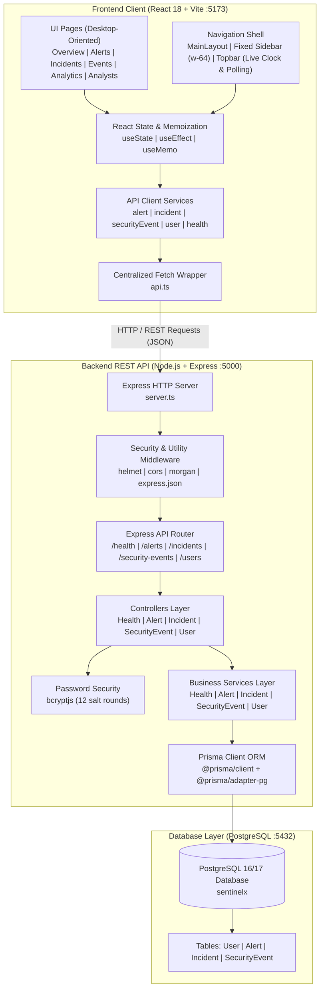

The diagram above represents the logical component topology of SentinelX. Figure 1 below presents the corresponding annotated system architecture diagram generated from the actual codebase structure.

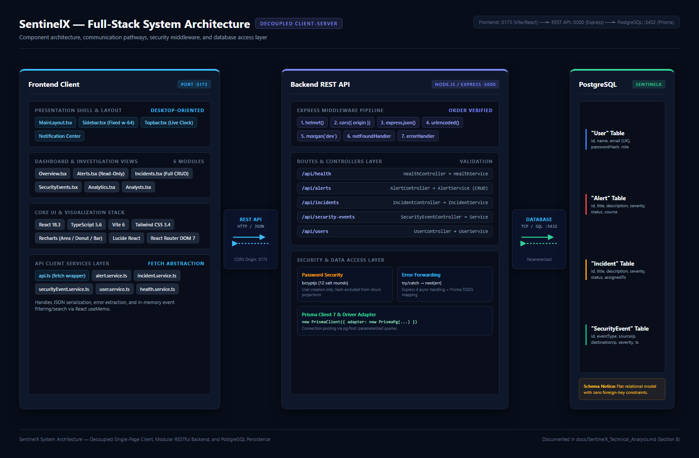

**Figure 1:** Annotated system architecture diagram for SentinelX, illustrating the decoupled frontend client (React 18 + Vite, port 5173), the Express REST API backend (port 5000), the middleware stack, the layered routes–controllers–services structure, and the PostgreSQL database accessed via Prisma ORM and `@prisma/adapter-pg` (port 5432).

---

## 9. Database Design and Data Modeling

### 9.1 Data Modeling Strategy
The database schema is defined declaratively in `backend/prisma/schema.prisma` and applied to PostgreSQL via Prisma Migrate. The schema models four distinct domain entities:
- **`User`:** Represents SOC personnel with access credentials and platform roles.
- **`Alert`:** Represents detected security threats and their operational triage states.
- **`Incident`:** Represents formal security investigations requiring assigned analyst oversight.
- **`SecurityEvent`:** Represents raw, timestamped network and system telemetry.

### 9.2 Entity Specifications and Schemas

#### 1. User Entity Model
```prisma
model User {
  id           String   @id @default(uuid())
  name         String
  email        String   @unique
  passwordHash String
  role         String   @default("analyst")
  createdAt    DateTime @default(now())
  updatedAt    DateTime @updatedAt
}
```
- `id` (String): Primary key generated as a version 4 UUID.
- `name` (String): Analyst's full personal or operational name.
- `email` (String): Unique operational email address; enforced via database unique constraint.
- `passwordHash` (String): 60-character bcrypt hash string.
- `role` (String): Functional role (`analyst`, `senior_analyst`, `admin`). Defaults to `analyst`.

#### 2. Alert Entity Model
```prisma
model Alert {
  id          String   @id @default(uuid())
  title       String
  description String
  severity    String
  status      String   @default("open")
  source      String
  createdAt   DateTime @default(now())
  updatedAt   DateTime @updatedAt
}
```
- `id` (String): Primary key UUID.
- `title` (String): Concise alert summary (e.g., "Multiple Failed Login Attempts").
- `description` (String): Detailed threat context and potential impact description.
- `severity` (String): Categorical severity level (`critical`, `high`, `medium`, `low`).
- `status` (String): Lifecycle state (`open`, `investigating`, `resolved`). Defaults to `open`.
- `source` (String): Telemetry origin (e.g., source IP `192.168.1.100` or system identifier).

#### 3. Incident Entity Model
```prisma
model Incident {
  id          String   @id @default(uuid())
  title       String
  description String
  severity    String
  status      String   @default("open")
  assignedTo  String?
  createdAt   DateTime @default(now())
  updatedAt   DateTime @updatedAt
}
```
- `id` (String): Primary key UUID.
- `title` (String): Formal investigation title.
- `description` (String): In-depth incident findings and containment scope.
- `severity` (String): Incident criticality (`critical`, `high`, `medium`, `low`).
- `status` (String): Investigation lifecycle state (`open`, `investigating`, `contained`, `resolved`, `closed`).
- `assignedTo` (String, Optional): Free-text name or identifier of the assigned analyst.

#### 4. SecurityEvent Entity Model
```prisma
model SecurityEvent {
  id            String   @id @default(uuid())
  eventType     String
  sourceIp      String
  destinationIp String?
  description   String
  severity      String
  timestamp     DateTime @default(now())
  createdAt     DateTime @default(now())
}
```
- `id` (String): Primary key UUID.
- `eventType` (String): Categorical classification (e.g., `Port Scan`, `Failed Login`, `Malware Detected`).
- `sourceIp` (String): Origin IPv4/IPv6 address.
- `destinationIp` (String, Optional): Target IPv4/IPv6 address.
- `description` (String): Raw telemetry payload or human-readable event log description.
- `severity` (String): Event severity level (`critical`, `high`, `medium`, `low`).
- `timestamp` (DateTime): Actual recorded time of event occurrence; defaults to ingestion time.

---

### 9.3 Database Constraints and Indexing Analysis
Based strictly on the verified migration file (`backend/prisma/migrations/20261108145824_init/migration.sql`), the database schema implements the following structural properties:
- **Primary Keys:** Each table enforces an explicit primary key constraint (`CONSTRAINT "Model_pkey" PRIMARY KEY ("id")`).
- **Unique Indexes:** A single unique index exists in the database: `CREATE UNIQUE INDEX "User_email_key" ON "User"("email")`.
- **Absence of Secondary Query Indexes:** There are currently **no secondary indexes** defined on query-heavy columns:
  - `SecurityEvent("timestamp")`
  - `SecurityEvent("eventType")`
  - `Alert("status")`
  - `Alert("severity")`
  - `Incident("status")`
  While completely acceptable for small development datasets, the lack of secondary indexes represents an architectural consideration for future ingestion scaling, as large tables will require full sequential scans.

---

### 9.4 Architectural Absence of Foreign-Key Relationships
A critical architectural observation identified during the system audit is that **the database operates with zero foreign-key constraints**:
1. **Unlinked Incident Assignment:** `Incident.assignedTo` stores an arbitrary, nullable string (e.g., `"Sarah Connor"` or `"analyst-1"`) rather than a formal foreign key referencing `User.id`. Consequently:
   - If a user is deleted from the database, existing incidents retain dangling string references.
   - The database cannot enforce that an assigned incident belongs to a legitimate registered analyst.
2. **Unlinked Alerts and Events:** An `Alert` cannot programmatically link to the underlying `SecurityEvent` rows that caused it.
3. **Unlinked Alerts and Incidents:** An `Incident` cannot maintain a foreign-key relationship to the `Alert` records that were escalated into it.

This flat relational design was adopted during early MVP prototyping to simplify database seeding and isolated table testing. However, formalizing foreign keys represents a key requirement for future development phases.

---

### 9.5 Entity-Relationship (ER) Diagram

The following Mermaid diagram accurately models the database schema as implemented in PostgreSQL:

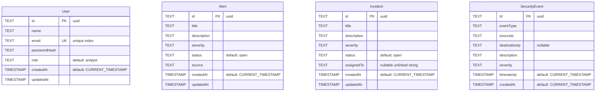

*Note: Entities are depicted without relationship connection lines, accurately reflecting the absence of foreign-key constraints in the active database schema.*

Figure 2 below presents the annotated entity-relationship diagram generated from the actual Prisma schema, visually representing all four entities with their fields, data types, primary keys, and unique constraints.

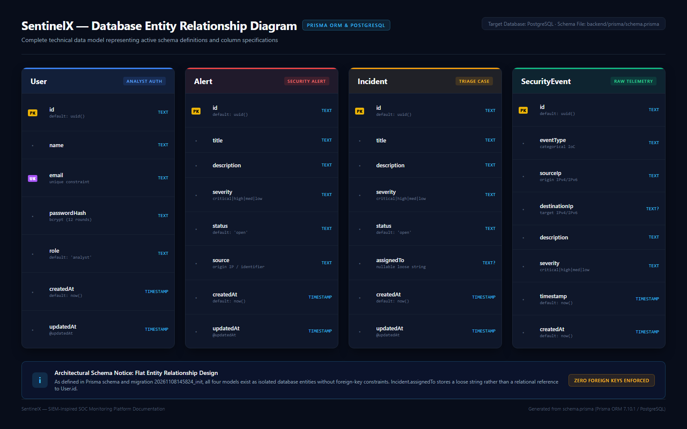

**Figure 2:** Database entity-relationship diagram for SentinelX, depicting the four PostgreSQL tables (`User`, `Alert`, `Incident`, `SecurityEvent`) as independent entities with their respective UUID primary keys, field types, and constraints. No foreign-key relationship lines are drawn, accurately reflecting the flat schema design of the current implementation.

---

## 10. System Implementation

### 10.1 Security Overview Dashboard (`Overview.tsx`)
- **Purpose:** Serves as the primary operational landing view, synthesizing overall organizational security posture for SOC supervisors.
- **Functionality:**
  - Displays four primary KPI cards: Total Alerts, Open Incidents, Critical Alerts, and Total Security Events.
  - Renders a 7-day rolling activity area chart plotting daily security events.
  - Displays a Recharts donut chart illustrating threat severity distribution with custom SVG glow filters.
  - Shows a recent alerts summary table listing the latest 4 alerts.
  - Provides a 4-component system health status grid.
- **Frontend Implementation:** Built in `frontend/src/pages/Overview.tsx`. Utilizes `useState` hooks to manage data arrays, `useEffect` to trigger concurrent fetches via `Promise.all`, and Recharts components (`AreaChart`, `PieChart`, `ResponsiveContainer`).
- **Data Flow & Reality Check:**
  - *Dynamic Data:* Total counts, open incident tallies, critical alert counts, 7-day event grouping, severity proportions, recent alert rows, and API/DB health pings reflect actual PostgreSQL records.
  - *Static Data:* The percentage change badges (`+12.5%`, `-8.2%`, etc. `"Compared to last week"`) and subsystem status cards ("Event Ingestion" and "Alert Monitoring" marked as `"Not monitored"`) are hardcoded strings.

Figure 3 illustrates the SOC Overview Dashboard as rendered in the browser, displaying live KPI cards, the 7-day activity chart, severity distribution, and the recent alerts table.

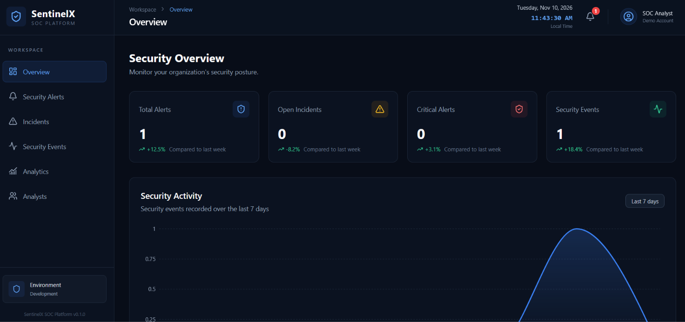

**Figure 3:** SentinelX Security Operations Center overview dashboard (`Overview.tsx`), presenting real-time KPI summary cards (Total Alerts, Open Incidents, Critical Alerts, Total Security Events), a 7-day rolling activity area chart, a severity distribution donut chart, and a recent alerts table, all populated from live PostgreSQL records.

---

### 10.2 Security Alerts Management Module (`Alerts.tsx`)
- **Purpose:** Provides a centralized queue for reviewing detected security threats.
- **Functionality:** Renders detected alerts in a tabular format showing title, description, categorical severity badge, source IP, lifecycle status, and detection timestamp.
- **Backend vs. Frontend Disparity:**
  - *Backend Capability:* The Express backend API provides full CRUD support (`GET /api/alerts`, `GET /api/alerts/:id`, `POST /api/alerts`, `PATCH /api/alerts/:id`, `DELETE /api/alerts/:id`).
  - *Frontend Implementation:* The `Alerts.tsx` frontend page is **strictly read-only**. It fetches alerts via `getAlerts()` and renders them to the screen. It provides no user interface controls for adding alerts, modifying status, or deleting records.

Figure 4 shows the Alerts Management interface as rendered in the browser.

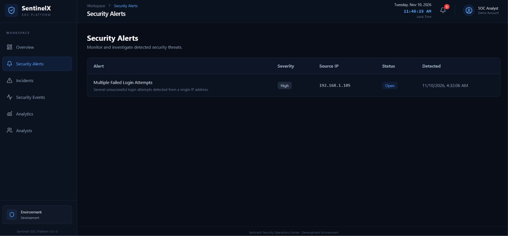

**Figure 4:** SentinelX Security Alerts Management page (`Alerts.tsx`), presenting a read-only tabular view of detected alerts with severity badges, source identifiers, lifecycle status indicators, and detection timestamps sourced from the `Alert` database table.

---

### 10.3 Incident Management and Investigation Module (`Incidents.tsx`)
- **Purpose:** Enables structured incident response, investigation tracking, and analyst assignment.
- **Functionality:**
  - **Incident Creation:** A collapsible modal form allows analysts to submit new incidents with titles, descriptions, severities, and optional analyst assignments via `POST /api/incidents`.
  - **Inline Status Updates:** Analysts can immediately change incident states (`open`, `investigating`, `contained`, `resolved`, `closed`) via table-row dropdowns, which trigger asynchronous `PATCH /api/incidents/:id` requests.
  - **Inline Analyst Assignment:** Provides a draft text input and a "Save" action button on each row, allowing dynamic updates to the `assignedTo` field.
- **Frontend Implementation:** Built in `frontend/src/pages/Incidents.tsx`. Manages local state optimistically, provides loading indicators (`Updating...`, `Saving...`), and surfaces error banners upon API rejections.
- **Data Flow:** Fully interactive and connected end-to-end to backend services and PostgreSQL persistence.

Figure 5 illustrates the Incident Management interface, and Figure 6 presents the analyst-driven incident lifecycle workflow diagram.

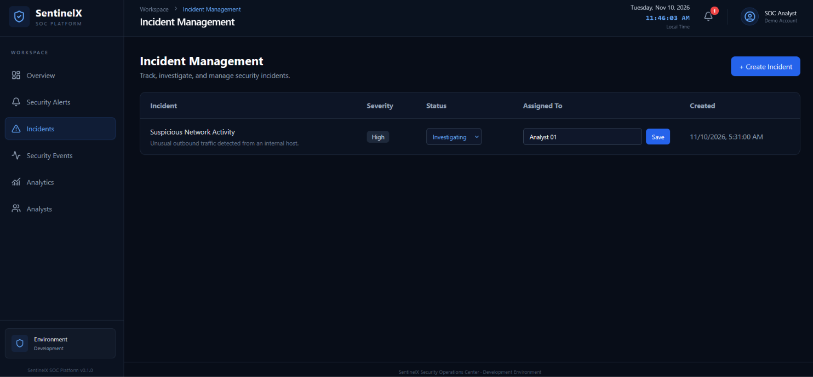

**Figure 5:** SentinelX Incident Management page (`Incidents.tsx`), showing the incident queue with inline status dropdowns, analyst assignment text inputs, severity badges, and the collapsible incident creation form. All interactions communicate with the backend via `POST` and `PATCH` requests against `/api/incidents`.

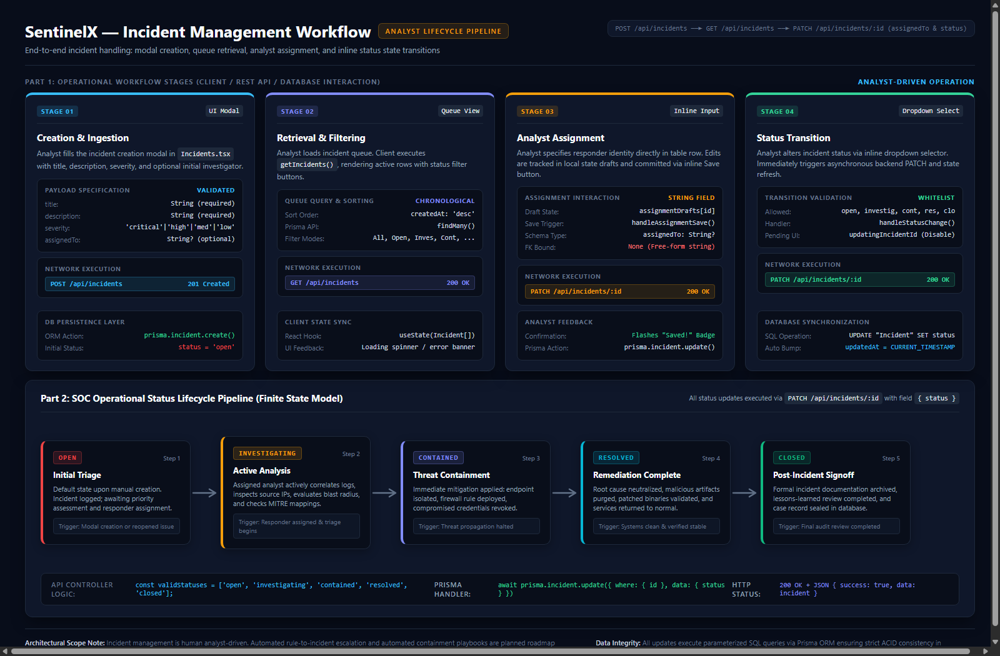

**Figure 6:** SentinelX incident management workflow diagram illustrating the four operational stages (incident creation via `POST /api/incidents`, queue retrieval via `GET /api/incidents`, analyst assignment, and inline status updates via `PATCH /api/incidents/:id`) and the five-state SOC status lifecycle (`open` → `investigating` → `contained` → `resolved` → `closed`), all executed through analyst-driven interactions.

---

### 10.4 Security Event Log Explorer (`SecurityEvents.tsx`)
- **Purpose:** SIEM log explorer enabling deep inspection of raw security telemetry.
- **Functionality:**
  - Tabulates raw security events with event type, source IP, destination IP, severity badge, and formatted timestamps.
  - Surfaces top-level summary cards for Total, Critical, High, and Other events.
  - Real-time client-side multi-parameter search matching queries against event types, descriptions, and source/destination IP strings.
  - Categorical severity filtering dropdown (`all`, `critical`, `high`, `medium`, `low`).
  - Manual "Refresh" button triggering data re-fetching with spin animations.
- **Frontend Implementation:** Built in `frontend/src/pages/SecurityEvents.tsx`. Employs React `useMemo` hooks to execute fast in-memory search and filtering across the fetched telemetry array.

Figure 7 shows the Security Event Log Explorer interface as rendered in the browser.

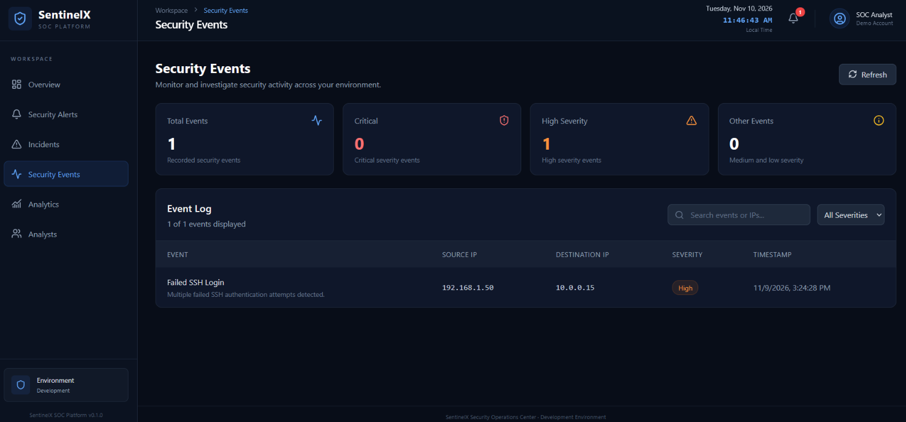

**Figure 7:** SentinelX Security Event Log Explorer (`SecurityEvents.tsx`), presenting summary metric cards for event severity counts, a searchable and filterable tabular log of raw `SecurityEvent` records, and a manual refresh control. Client-side filtering via `useMemo` enables multi-parameter search across event type, description, and IP fields without additional network requests.

---

### 10.5 Threat Analytics Module (`Analytics.tsx`)
- **Purpose:** Provides aggregate threat intelligence visualizations for pattern analysis and threat identification.
- **Functionality:**
  - Displays summary metric cards for Total Events, Critical Events, High Severity Events, and Active Incidents.
  - Renders a 7-day security activity trend line via an `<AreaChart>`.
  - Renders an interactive severity distribution donut chart.
  - Displays a horizontal `<BarChart>` identifying the top 6 most frequent threat event categories (e.g., `Failed Login`, `Port Scan`, `Privilege Escalation`).
- **Frontend Implementation:** Built in `frontend/src/pages/Analytics.tsx`. Fetches events, alerts, and incidents concurrently; derives all chart aggregations dynamically via `useMemo` computation.

Figure 8 shows the Threat Analytics dashboard as rendered in the browser.

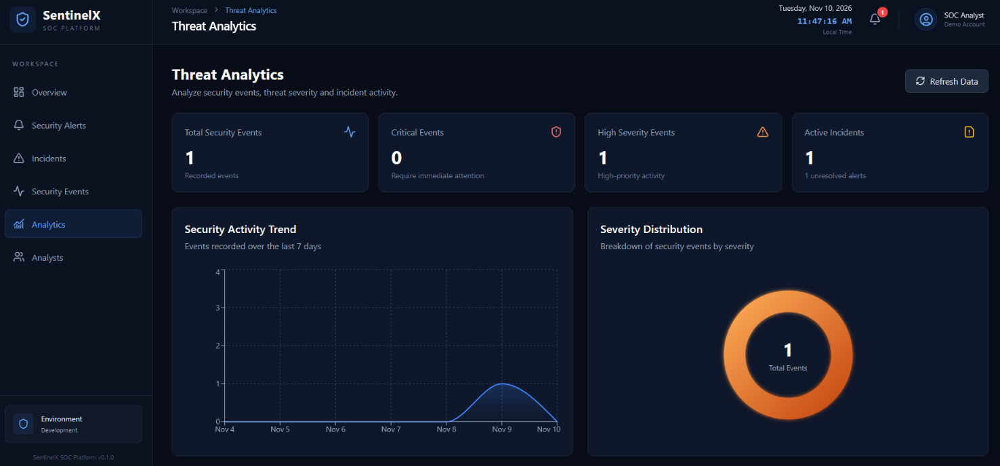

**Figure 8:** SentinelX Threat Analytics page (`Analytics.tsx`), displaying summary metric cards for event counts and active incidents, a 7-day security activity trend area chart, an interactive severity distribution donut chart, and a horizontal bar chart ranking the top threat event categories — all computed dynamically from live database records via `useMemo` aggregation.

---

### 10.6 Analyst and User Management Module (`Analysts.tsx`)
- **Purpose:** Provides team administration and operational role assignment for SOC personnel.
- **Functionality:**
  - Displays summary metrics: Total Analysts, Senior Analysts, and Administrators.
  - Registration form allowing administrators to create new analyst accounts by providing Full Name, Email, Password (min 8 chars), and Role (`analyst`, `senior_analyst`, `admin`).
  - Displays analyst profile cards with generated avatar initials, email, role badge, and account creation date.
- **Frontend & Backend Implementation:** Frontend is implemented in `frontend/src/pages/Analysts.tsx`. Form submissions invoke `POST /api/users`. The backend hashes the password using `bcryptjs` (12 rounds) before storing the user in PostgreSQL. The backend service explicitly excludes `passwordHash` from return projections, preventing credential leaks.

Figure 9 shows the Analyst and User Management interface as rendered in the browser.

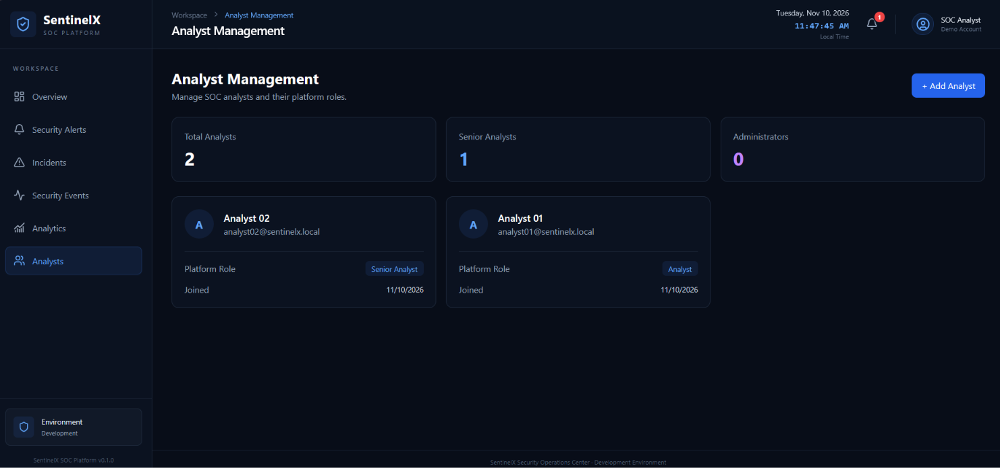

**Figure 9:** SentinelX Analyst and User Management page (`Analysts.tsx`), showing summary metrics for analyst counts by role, the analyst registration form (with server-side `bcryptjs` password hashing), and analyst profile cards displaying generated avatar initials, email addresses, role badges, and account creation dates.

---

### 10.7 Navigation and Persistent Notification Center (`Sidebar.tsx`, `Topbar.tsx`)
- **Sidebar (`Sidebar.tsx`):** Fixed 256px wide navigation panel utilizing React Router `NavLink` with active link styling, brand logo, and workspace environment status indicator.
- **Topbar (`Topbar.tsx`):** Sticky header featuring:
  - Live clock updating every 1,000 milliseconds with formatted local date and time.
  - Notification Bell icon polling `/api/alerts` every 30 seconds to compute the unresolved alert badge count (`alert.status !== 'resolved'`).
  - Notification flyout displaying the 5 most recent alerts with formatted timestamps and severity badges.
  - Static demo analyst profile indicator ("SOC Analyst", "Demo Account").

---

### 10.8 Backend API and Database Service Integration
The backend integrates Express routes, controllers, and Prisma services cleanly:
- Controllers validate payload types and non-empty strings before dispatching queries.
- Services query the `prisma` singleton instantiated in `backend/src/lib/prisma.ts`.
- Dedicated health endpoints in `HealthService` execute `$queryRaw\`SELECT 1\`` to verify database connectivity independently of application logic.

---

## 11. REST API Design and Endpoint Documentation

### 11.1 Architectural Principles
The SentinelX backend implements a RESTful API following standard design principles:
- **Resource-Oriented URI Structure:** Endpoints map cleanly to domain nouns (`/api/alerts`, `/api/incidents`, `/api/security-events`, `/api/users`, `/api/health`).
- **Standard HTTP Method Semantics:** `GET` for safe retrieval, `POST` for record creation, `PATCH` for partial record mutation, `DELETE` for removal.
- **Stateless Request Handling:** Each incoming request contains all necessary data for processing; no server-side HTTP session state is stored.

---

### 11.2 Endpoints Specification Table

The following table documents every API endpoint implemented in the SentinelX Express backend:

| HTTP Method | Full Endpoint Path | Controller Handler | Service Method | Request Body / Parameters | Success Status | Frontend Exposure |
| :--- | :--- | :--- | :--- | :--- | :---: | :--- |
| **GET** | `/api/health` | `HealthController.getHealth` | `HealthService.getHealth` | None | `200 OK` | Consumed (`Overview.tsx`) |
| **GET** | `/api/health/database` | `HealthController.getDatabaseHealth` | `HealthService.getDatabaseHealth` | None | `200 OK` / `503` | Consumed (`Overview.tsx`) |
| **GET** | `/api/alerts` | `AlertController.getAllAlerts` | `AlertService.getAllAlerts` | None | `200 OK` | Consumed across 4 pages |
| **GET** | `/api/alerts/:id` | `AlertController.getAlertById` | `AlertService.getAlertById` | Params: `id` (UUID) | `200 OK` | Not consumed in UI |
| **POST** | `/api/alerts` | `AlertController.createAlert` | `AlertService.createAlert` | Body: `{ title, description, severity, source }` | `201 Created` | Not consumed in UI |
| **PATCH** | `/api/alerts/:id` | `AlertController.updateAlert` | `AlertService.updateAlert` | Params: `id`; Body: `{ title?, description?, severity?, status?, source? }` | `200 OK` | Not consumed in UI |
| **DELETE** | `/api/alerts/:id` | `AlertController.deleteAlert` | `AlertService.deleteAlert` | Params: `id` (UUID) | `200 OK` | Not consumed in UI |
| **GET** | `/api/incidents` | `IncidentController.getAllIncidents` | `IncidentService.getAllIncidents` | None | `200 OK` | Consumed across 3 pages |
| **GET** | `/api/incidents/:id` | `IncidentController.getIncidentById` | `IncidentService.getIncidentById` | Params: `id` (UUID) | `200 OK` | Not consumed in UI |
| **POST** | `/api/incidents` | `IncidentController.createIncident` | `IncidentService.createIncident` | Body: `{ title, description, severity, assignedTo? }` | `201 Created` | Consumed (`Incidents.tsx`) |
| **PATCH** | `/api/incidents/:id` | `IncidentController.updateIncident` | `IncidentService.updateIncident` | Params: `id`; Body: `{ title?, description?, severity?, status?, assignedTo? }` | `200 OK` | Consumed (`Incidents.tsx`) |
| **DELETE** | `/api/incidents/:id` | `IncidentController.deleteIncident` | `IncidentService.deleteIncident` | Params: `id` (UUID) | `200 OK` | Not consumed in UI |
| **GET** | `/api/security-events` | `SecurityEventController.getAllEvents` | `SecurityEventService.getAllEvents` | None | `200 OK` | Consumed across 3 pages |
| **GET** | `/api/security-events/:id` | `SecurityEventController.getEventById` | `SecurityEventService.getEventById` | Params: `id` (UUID) | `200 OK` | Not consumed in UI |
| **POST** | `/api/security-events` | `SecurityEventController.createEvent` | `SecurityEventService.createEvent` | Body: `{ eventType, sourceIp, destinationIp?, description, severity }` | `201 Created` | Not consumed in UI |
| **GET** | `/api/users` | `UserController.getAllUsers` | `UserService.getAllUsers` | None | `200 OK` | Consumed (`Analysts.tsx`) |
| **GET** | `/api/users/:id` | `UserController.getUserById` | `UserService.getUserById` | Params: `id` (UUID) | `200 OK` | Not consumed in UI |
| **POST** | `/api/users` | `UserController.createUser` | `UserService.createUser` | Body: `{ name, email, password, role }` | `201 Created` | Consumed (`Analysts.tsx`) |

---

### 11.3 Request Lifecycle and Controller Flow
1. An incoming HTTP request arrives at `server.ts` and passes through global middlewares in `app.ts` (`helmet()`, `cors()`, `express.json()`).
2. Express matches the request path to `routes/index.ts`, delegating to the appropriate sub-router.
3. The sub-router invokes the static controller method.
4. The controller inspects payload boundaries:
   - Verifies mandatory string presence and executes `.trim()`.
   - Validates that categorical fields match accepted domain arrays (e.g., `validSeverities = ['critical', 'high', 'medium', 'low']`).
5. The controller invokes the corresponding static service method.
6. The service executes database queries via Prisma ORM.
7. Upon successful execution, the controller emits an appropriate HTTP status code (`200 OK` or `201 Created`) with a formatted JSON payload.
8. If an unhandled exception occurs, it is forwarded via `next(error)` to `errorHandler.ts`.

---

### 11.4 Error Handling and Response Inconsistencies
The technical audit revealed an architectural inconsistency in error response formatting between layers:
- **Manual Controller Errors:** In `AlertController` and `IncidentController`, validation failures return:
  ```json
  { "success": false, "message": "Invalid alert data or missing required fields" }
  ```
- **Middleware and Event Controller Errors:** In `SecurityEventController` and the global `errorHandler.ts`, failures return:
  ```json
  { "success": false, "error": { "message": "Resource not found", "statusCode": 404 } }
  ```
- **Frontend Impact:** The frontend fetch wrapper (`frontend/src/services/api.ts:19`) attempts to extract errors via `throw new Error(result.message || 'Something went wrong')`. When an error is produced by the global middleware (which nests the message under `result.error.message`), `result.message` evaluates to `undefined`, causing the frontend UI to display the generic fallback `'Something went wrong'` rather than the specific server error.

---

## 12. Cybersecurity Evaluation and Security Considerations

### 12.1 Implemented Security Controls
1. **HTTP Security Headers:** Express applies `helmet()`, adding standard HTTP protection headers by default:
   - `X-Content-Type-Options: nosniff` (prevents MIME-type confusion attacks).
   - `X-Frame-Options: SAMEORIGIN` (mitigates clickjacking in framed environments).
   - `Strict-Transport-Security` (enforces HTTPS transport).
   - `X-DNS-Prefetch-Control` and basic `Content-Security-Policy`.
2. **Cryptographic Password Hashing:** User passwords are encrypted using `bcryptjs` with 12 salt rounds before database storage. Plaintext passwords are never logged or stored.
3. **Sensitive Field Exclusion:** `UserService` explicitly uses Prisma `select` projections to exclude `passwordHash` from user retrieval queries, preventing credential hashes from reaching client browsers.
4. **Environment Isolation:** Secrets and database connection URIs are stored in `.env` files and excluded from git version control via `.gitignore`.

---

### 12.2 CORS Policy and Browser Boundary Analysis
The backend enables Cross-Origin Resource Sharing restricted to the frontend origin:
```typescript
app.use(cors({ origin: config.corsOrigin, credentials: true }));
```
> [!IMPORTANT]
> **CORS is a browser-enforced security mechanism, not an authentication or API authorization control.**
> CORS instructs compliant web browsers to block malicious scripts hosted on third-party domains from reading API responses across origins. It provides **zero security against non-browser HTTP clients** (such as `curl`, Postman, Python scripts, or automated vulnerability scanners). Because the SentinelX API endpoints currently lack authentication tokens, any external client can issue requests directly to `http://localhost:5000/api/` and perform CRUD operations unimpeded.

---

### 12.3 SQL Injection Defenses and Parameterized Query Limitations
Database interactions in SentinelX are mediated by Prisma ORM:
- Model queries (`prisma.alert.findMany()`, `prisma.incident.create()`, etc.) and the health query (`prisma.$queryRaw\`SELECT 1\``) compile into **parameterized SQL queries**.
- In parameterized queries, user inputs are transmitted to the PostgreSQL engine separately from the SQL instruction structure, neutralizing standard SQL injection techniques (such as `' OR '1'='1`).

> [!NOTE]
> While Prisma effectively mitigates standard SQL injection patterns, this **does not claim that all injection or data tampering risks are universally eliminated**:
> - If developers later introduce `prisma.$queryRawUnsafe()` using unsanitized string concatenation, SQL injection vulnerabilities can still emerge.
> - Parameterized queries provide zero protection against business-logic injection, data pollution, or unauthorized API access.

---

### 12.4 Password Storage Security
Password handling in `UserController.createUser` adheres to recommended cryptographic guidelines:
- Requires a minimum password length of 8 characters.
- Uses `bcrypt.hash(password, 12)`, which provides adequate resistance against offline brute-force attacks on modern computing hardware.
- Passwords are encrypted before database insertion and are never returned in API response bodies.

---

### 12.5 Critical Security Gaps and Threat Analysis

| Security Gap / Vulnerability | Risk Severity | Impact Description |
| :--- | :--- | :--- |
| **Complete Lack of Authentication** | **Critical** | All REST API endpoints are public. Anyone with network access can view, modify, or delete alerts, incidents, and analysts without credentials. |
| **Unprotected Admin Registration** | **High** | `POST /api/users` is open to unauthenticated requests, allowing anyone to register new user accounts with `role: "admin"`. |
| **Missing Rate Limiting** | **Medium** | No rate-limiting middleware (`express-rate-limit`) is active. The backend is vulnerable to denial-of-service (DoS) and automated registration abuse. |
| **Absence of Audit Logging** | **Medium** | Destructive actions (e.g., deleting an alert via `DELETE /api/alerts/:id`) occur without logging who performed the operation, from what IP, or at what time. |
| **Unbounded Query Payloads** | **Medium** | Endpoints return entire tables without pagination. In a real SOC handling millions of events, fetching all records will crash the Node.js process and browser. |

---

## 13. Testing, Build Verification, and Quality Assurance

### 13.1 Compile-Time TypeScript Verification
Static type checking was executed across both frontend and backend codebases:
- **Backend Build (`npm run build` in `backend/`):**
  - Executed `tsc` under TypeScript 5.6.3 with `NodeNext` ESM module resolution.
  - Successfully compiled the entire backend into `backend/dist/` in **8.2 seconds** with **zero type errors**.
- **Frontend Build (`npm run build` in `frontend/`):**
  - Executed `tsc -b && vite build`.
  - Successfully compiled all React components and generated production assets in **16.38 seconds** with **zero type errors**.
  - Generated output: `dist/index.html` (0.52 kB), `dist/assets/index-COdECT_A.css` (19.44 kB), and `dist/assets/index-C_lljgI8.js` (665.41 kB).

---

### 13.2 Production Bundle Build Verification
The Vite build process produced a minification warning:
```text
(!) Some chunks are larger than 500 kB after minification:
dist/assets/index-C_lljgI8.js is 665.41 kB (gzip: 193.57 kB)
```
- **Technical Cause:** Recharts, Lucide React icons, and React Router DOM are compiled into a single monolithic vendor chunk.
- **Remediation Strategy:** Implement code-splitting using `React.lazy()` for top-level page components and configure manual Rollup vendor chunks in `vite.config.ts`.

---

### 13.3 Distinction Between Build Verification and Runtime Testing
It is vital to distinguish static compile-time verification from live runtime integration testing:
- **Verified:** TypeScript types, JSX syntax, import resolutions, and production asset generation are completely valid and compile cleanly.
- **Unverified at Runtime:** **No live PostgreSQL database was connected during this audit.** Consequently, live database network pooling, actual SQL query execution latency, runtime Prisma adapter stability, and end-to-end browser-to-database mutations were not executed during this assessment.

---

### 13.4 Verification Gaps and Unverified Runtime Behaviors
The following runtime scenarios require an active PostgreSQL instance and automated testing framework to verify:
1. **Live Database Connectivity:** Validating that `@prisma/adapter-pg` correctly handles connection pooling under continuous traffic.
2. **Duplicate Email Error Behavior:** Verifying whether registering duplicate emails triggers an unhandled `P2002` Prisma crash returning HTTP 500 rather than a clean HTTP 409 Conflict.
3. **Empty-State Chart Rendering:** Verifying that Recharts SVG gradient filters render without errors when database tables contain zero records.
4. **Automated Unit and Integration Tests:** While Vitest and Supertest were listed in original requirements, no automated test files exist in the repository.

---

## 14. Results and Technical Discussion

### 14.1 Functional Outcomes
The development of SentinelX resulted in a functional full-stack prototype that demonstrates core SOC monitoring concepts:
- Operational React single-page dashboard featuring six distinct views.
- Cleanly architected Express REST API following routes-controllers-services separation.
- Relational schema modeling four essential cybersecurity monitoring entities.
- Live telemetry aggregation deriving charts, activity trends, and status indicators from real database records.

---

### 14.2 Support for SOC Analyst Workflows
The prototype supports key triage workflows:
- **Situational Overview:** Analysts gain immediate awareness of active alerts and incident volumes upon loading the dashboard.
- **Incident Lifecycle Management:** The interactive Incidents view allows teams to move tickets through formal containment and resolution phases while assigning accountability.
- **Log Exploration:** The Security Events view provides rapid client-side searching across multiple fields, allowing analysts to correlate disparate event logs during investigations.

---

### 14.3 Software Engineering Challenges and Decisions
1. **Adopting Prisma 7 Driver Adapters:** The backend adopted Prisma 7 with `@prisma/adapter-pg`. This required configuring `backend/prisma.config.ts` and managing NodeNext ESM import specifiers (requiring explicit `.js` extensions on local imports in TypeScript).
2. **SVG Filters and KaTeX Compatibility:** Styling Recharts donut charts with custom SVG glow filters required careful isolation to prevent CSS styling conflicts with dark-theme containers.
3. **Decoupled Application Scripts:** Monorepo package scripts were established to allow both applications to be launched independently (`npm run dev:frontend`, `npm run dev:backend`) or orchestrated from root.

---

### 14.4 Critique of the Prototype Nature
While SentinelX succeeds as an architectural and educational demonstration, it is fundamentally a prototype:
- It lacks automated detection logic; events and alerts are static database entities rather than dynamic streams.
- It operates without an authentication perimeter, making it unsuitable for deployment outside isolated development environments.
- Its data visualization layer loads entire tables into browser memory, which is unviable for enterprise-scale log volumes.

---

## 15. System Limitations and Known Technical Debt

### 15.1 Architectural and Security Limitations
1. **No Authentication Gateway:** All endpoints are completely open and unauthenticated.
2. **No Role-Based Access Enforcement:** User roles (`analyst`, `senior_analyst`, `admin`) are stored in the database but never verified by authorization middleware.
3. **CORS Misconception:** Cross-origin restrictions protect only against browser-origin requests, leaving the API vulnerable to direct HTTP tool invocation.
4. **No Audit Trails:** Destructive state mutations occur without permanent audit logging.
5. **Absence of Foreign Keys:** Database entities exist as isolated silos without relational integrity constraints.

### 15.2 Functional and User Interface Limitations
1. **Read-Only Alerts View:** The frontend `Alerts.tsx` page cannot create, update, or delete alerts, despite backend API support.
2. **Static Dashboard Indicators:** KPI percentage changes (`+12.5%`, etc.) and secondary subsystem monitoring cards (`Not monitored`) are hardcoded strings.
3. **Desktop-Only Layout:** The fixed 256px sidebar and hardcoded left margin (`ml-64`) do not collapse into a mobile drawer, causing severe layout squishing on mobile viewports.
4. **Full-Page Navigation Glitch:** The Topbar notification flyout uses `window.location.href = '/alerts'`, causing an unnecessary browser reload instead of React Router navigation.

### 15.3 Scalability and Performance Limitations
1. **Unbounded Queries & Missing Pagination:** Endpoints execute unpaginated `findMany` queries, creating memory exhaustion risks under heavy event loads.
2. **Absence of Performance Indexes:** Secondary indexes on high-frequency query columns (`timestamp`, `severity`, `status`) are missing.
3. **Monolithic Vendor Bundle:** The frontend bundle exceeds 665 kB due to un-split third-party visualization libraries.

---

## 16. Future Enhancements and Project Roadmap

The proposed future roadmap for SentinelX encompasses four major development phases:

```
Phase 1: Identity & Security  ──► Phase 2: Detection Engine  ──► Phase 3: Schema Normalization ──► Phase 4: Enterprise Scale
- JWT Auth (Login/Logout)         - Event Simulation Daemon      - Foreign Key Relations            - Server-Side Pagination
- RBAC Middleware                 - Threshold Rule Engine        - MITRE ATT&CK Matrix              - Automated Tests (Vitest)
- Protected Frontend Routes       - Dynamic Alert Generation     - Audit Log Table                  - Mobile Responsive Drawer
```

### 16.1 Security and Identity Enhancements
- Implement a formal authentication module using JSON Web Tokens (JWT) with HTTP-only refresh cookies.
- Create an RBAC authorization middleware (`requireRole(['admin', 'senior_analyst'])`) protecting administrative routes.
- Introduce client-side route guards (`<AuthGuard>`) redirecting unauthenticated users to a dedicated login view.

### 16.2 Detection Engine and Event Generation Simulation
- Construct an **Event Generator Daemon** simulating realistic security telemetry streams.
- Implement attack scenario generators:
  - Brute-force login attempts (repeated failed auth events from a single IP).
  - Suspicious PowerShell executions (encoded command-line arguments).
  - Network port scanning (sequential connection requests across multiple ports).
  - Outbound data exfiltration (high-volume data transfers to external IPs).
- Construct a **Rule-Based Threat Detection Engine** that continuously evaluates event streams against threshold rules and automatically inserts `Alert` records into the database.

### 16.3 Relational Schema Normalization and MITRE Mapping
- Refactor `backend/prisma/schema.prisma` to establish foreign keys:
  - `Incident.assignedToUserId` referencing `User.id`.
  - `Alert.incidentId` referencing `Incident.id` (optional escalation).
  - A many-to-many relationship linking `Alert` to triggering `SecurityEvent` rows.
- Map security events and detection rules to **MITRE ATT&CK Tactics and Techniques** (e.g., `T1110 - Brute Force`, `T1059.001 - PowerShell`).
- Create an `AuditLog` table recording all analyst actions.

### 16.4 Performance, Pagination, and Testing Frameworks
- Implement server-side cursor-based pagination (`limit`, `cursor`) on `/api/security-events` and `/api/alerts`.
- Refactor `App.tsx` with `React.lazy()` code-splitting to reduce the production bundle size below 200 kB.
- Implement an automated testing suite utilizing **Vitest** for unit tests and **Supertest** for API integration testing.
- Refactor `Sidebar.tsx` into a responsive drawer with an accessible hamburger toggle for mobile devices.

---

## 17. Conclusion

### 17.1 Summary of Contributions
SentinelX demonstrates the design, software engineering implementation, and evaluation of an intermediate-level, full-stack SOC monitoring dashboard prototype. The project successfully demonstrates:
- A cleanly decoupled client-server architecture using modern TypeScript across both tiers.
- Live security metric visualization using React 18, Tailwind CSS, and Recharts.
- A functional incident investigation lifecycle with inline status transitions and analyst assignment.
- An extensible REST API adhering to layered routes-controllers-services design patterns.
- Persistent relational modeling via PostgreSQL and Prisma ORM 7.

### 17.2 Evaluation of Objective Fulfillment
The project successfully fulfilled its primary software engineering objectives:
- Full-stack type safety was achieved with zero compilation errors across both applications.
- Telemetry displays, activity charts, severity breakdowns, and analyst listings reflect actual database queries.
- Clean separation of concerns was maintained throughout the codebase.

Secondary objectives related to advanced detection automation, authentication perimeters, and relational normalization remain uncompleted, representing clear directions for future development.

### 17.3 Academic and Educational Value
From an academic perspective, SentinelX provides significant educational value. It demystifies the complex architectural pipelines that power enterprise SIEM platforms, demonstrating how web engineering concepts directly serve cybersecurity operations. The project serves as an auditable foundation for further academic exploration into automated threat detection, log correlation, and security operations workflows.

---

## 18. References

1. **National Institute of Standards and Technology (NIST).** (2012). *Computer Security Incident Handling Guide* (NIST Special Publication 800-61, Revision 2). U.S. Department of Commerce. https://doi.org/10.6028/NIST.SP.800-61r2
2. **The MITRE Corporation.** (2024). *MITRE ATT&CK®: Design and Principles*. MITRE Corporation. https://attack.mitre.org/
3. **Open Web Application Security Project (OWASP).** (2021). *OWASP Top 10:2021 — The Ten Most Critical Web Application Security Risks*. OWASP Foundation. https://owasp.org/Top10/
4. **React Documentation.** (2024). *React 18 Architecture and Concurrent Features*. Meta Open Source. https://react.dev/
5. **Node.js Documentation.** (2024). *Node.js v22.x LTS Documentation and API Reference*. OpenJS Foundation. https://nodejs.org/docs/latest-v22.x/api/
6. **Express.js Documentation.** (2024). *Express 4.x API Reference and Routing Guide*. OpenJS Foundation. https://expressjs.com/
7. **Prisma Documentation.** (2024). *Prisma ORM Reference, Driver Adapters, and PostgreSQL Configuration*. Prisma Data, Inc. https://www.prisma.io/docs/
8. **PostgreSQL Global Development Group.** (2024). *PostgreSQL 16 Database Documentation*. PostgreSQL.org. https://www.postgresql.org/docs/16/
9. **Tailwind CSS Documentation.** (2024). *Tailwind CSS Utility-First Framework Documentation (v3.4)*. Tailwind Labs. https://tailwindcss.com/docs
10. **Recharts Documentation.** (2024). *Recharts: Redefined Chart Library Built on React and SVG*. Recharts Community. https://recharts.org/
11. **Internet Engineering Task Force (IETF).** (2014). *Hypertext Transfer Protocol (HTTP/1.1): Semantics and Content* (RFC 7231). IETF Trust. https://datatracker.ietf.org/doc/html/rfc7231
12. **Fielding, R. T.** (2000). *Architectural Styles and the Design of Network-based Software Architectures* (Doctoral dissertation). University of California, Irvine.
