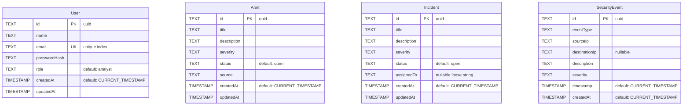
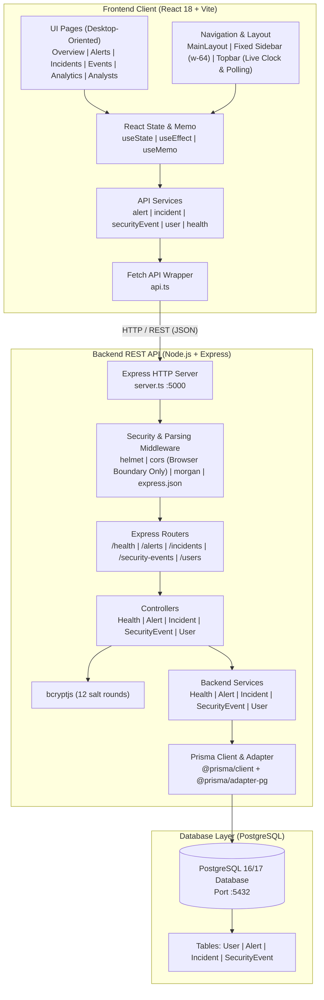

# SentinelX — Technical Analysis and System Audit

**Document Version:** 1.1.0 (Audited & Corrected Edition)  
**Audit Date:** November 10, 2026  
**Auditor:** Senior Full-Stack Software Engineer, Software Architect & Cybersecurity Analyst  
**Target Repository:** SentinelX (`SentinelIX`)  
**Scope:** Repository inspection, architectural evaluation, frontend/backend source audit, REST API analysis, database schema verification, cybersecurity posture assessment, and implementation gap analysis.

---

## 1. Executive Summary

SentinelX is a full-stack, SIEM-inspired Security Operations Center (SOC) monitoring platform prototype designed to demonstrate telemetry aggregation, threat visualization, incident triage, and analyst workflow management.

This audit evaluates the codebase as of commit `4cbc367` (`docs: update project README`), following the MVP buildout (`8da3868`). The application features an operational React 18 single-page application (SPA) with Tailwind CSS and Recharts, an Express.js 4 backend written in TypeScript with NodeNext ESM module resolution, and a PostgreSQL database managed via Prisma ORM 7.10.1 with the `@prisma/adapter-pg` driver adapter.

### High-Level Audit Findings

1. **Static Build Verification vs. Runtime Testing**: Both the backend and frontend compile cleanly without TypeScript or Vite build errors. However, **this audit performed static code analysis and build verification only**. No live database instance was active, and live end-to-end runtime integration, network socket latency, and database connectivity were not executed or verified at runtime.
2. **Data Consumption: Dynamic Counts vs. Static Indicators**: Primary dashboard metric totals (Total Alerts, Open Incidents, Critical Alerts, Total Security Events), 7-day activity area chart trends, severity breakdown percentages, top event type bars, and recent alert tables derive their data from backend database records. Conversely, **KPI percentage comparisons (`+12.5%`, `-8.2%`, etc. "Compared to last week") and subsystem monitoring statuses ("Event Ingestion" and "Alert Monitoring") are hardcoded static strings**.
3. **Backend API vs. Frontend Capability Disparity**: A significant disparity exists between backend capabilities and frontend exposure. Most notably, **the backend REST API provides full CRUD capabilities for Alerts** (create, read, update, delete), whereas **the current frontend Alerts page is strictly read-only**, offering no UI for alert creation, status transitions, or deletion.
4. **Core Architectural Gaps**:
   - **No Automated Detection Engine or Event Generator**: Security events and alerts exist solely as independent database entities. There is currently no rule engine, threshold monitor, or background worker that dynamically processes raw security events to generate alerts.
   - **Absence of Authentication & Authorization**: While the backend includes `bcryptjs` password hashing and stores user roles (`analyst`, `senior_analyst`, `admin`), there is no authentication mechanism (e.g., JWT, session cookies), no login/logout routes, and no authorization middleware guarding API endpoints or frontend routes.
   - **Browser-Only Boundary (CORS is Not Authorization)**: Express configures CORS for `http://localhost:5173`, but CORS is solely a browser-enforced origin policy. It does not authenticate requests or restrict access from non-browser HTTP clients (e.g., curl, Postman, scripts).
   - **Loose Relational Integrity**: The database schema defines four standalone tables (`User`, `Alert`, `Incident`, `SecurityEvent`) with zero foreign keys or relational constraints linking them (e.g., `Incident.assignedTo` is an unconstrained string rather than a foreign key referencing `User.id`).
   - **Desktop-Oriented UI**: The user interface relies on a fixed-width sidebar (`w-64`) without a mobile responsive drawer or collapsible navigation.
   - **Missing Advanced Modules**: Asset/endpoint inventory, MITRE ATT&CK matrix mapping, automated attack simulation scenarios, and tamper-evident audit logs are not implemented.

---

## 2. Project Overview

| Attribute | Specification |
| :--- | :--- |
| **Project Name** | SentinelX (Repository: `SentinelIX`) |
| **System Category** | SIEM / SOC Telemetry Monitoring Dashboard (Prototype) |
| **Target Architecture** | Decoupled Client-Server (RESTful API) |
| **Frontend Runtime** | React 18.3.1, TypeScript 5.6.3, Vite 6.0.1, Tailwind CSS 3.4.16, Recharts 3.10.1 |
| **Backend Runtime** | Node.js v22.20.0, Express 4.21.2, TypeScript 5.6.3 (`NodeNext`), `tsx` 4.19.2 |
| **Database & ORM** | PostgreSQL 16/17, Prisma ORM 7.10.1 (`@prisma/client`, `@prisma/adapter-pg`, `pg` 8.23.1) |
| **Security Utilities** | `helmet` 8.0.0, `cors` 2.8.5, `bcryptjs` 3.0.3 |
| **Current Git Commit** | `4cbc367` (Clean working tree) |
| **Verification Level** | Static Code Analysis, AST Typechecking, Production Build Verification |

---

## 3. Complete Project Structure

```
SentinelIX/
├── .gitignore                         # Git exclusion rules for node_modules, dist, .env, tsbuildinfo
├── package.json                       # Workspace orchestrator (scripts for root, backend, frontend)
├── README.md                          # Public repository documentation & setup instructions
├── docs/
│   ├── ARCHITECTURE.md                # High-level architecture specification
│   └── SentinelX_Technical_Analysis.md # Comprehensive system audit report (this document)
│
├── frontend/                          # Client-side Single Page Application
│   ├── public/
│   │   └── vite.svg                   # Application favicon/brand asset
│   ├── src/
│   │   ├── components/
│   │   │   ├── common/                # Shared reusable UI primitives (currently empty directory)
│   │   │   ├── dashboard/             # Dashboard widget components (currently empty directory)
│   │   │   └── layout/
│   │   │       ├── MainLayout.tsx     # Desktop-oriented layout container with fixed sidebar & Topbar
│   │   │       ├── Sidebar.tsx        # Fixed-width navigation sidebar (w-64) with route links
│   │   │       └── Topbar.tsx         # Sticky header with breadcrumbs, clock, notifications & profile
│   │   ├── pages/
│   │   │   ├── Alerts.tsx             # Read-only security alerts table view
│   │   │   ├── Analysts.tsx           # SOC analyst management, role overview & creation form
│   │   │   ├── Analytics.tsx          # Threat intelligence charts, trends & distributions
│   │   │   ├── Incidents.tsx          # Incident management, inline status updates & analyst assignment
│   │   │   ├── Overview.tsx           # Executive SOC dashboard (KPIs, activity chart, severity donut)
│   │   │   └── SecurityEvents.tsx     # Security event log explorer with real-time filtering & search
│   │   ├── services/
│   │   │   ├── alert.service.ts       # Alert API client (implements GET /api/alerts only)
│   │   │   ├── api.ts                 # Base HTTP fetch wrapper with error response extraction
│   │   │   ├── health.service.ts      # Server & database health status API client
│   │   │   ├── incident.service.ts    # Incident CRUD API client methods & mutation payloads
│   │   │   ├── securityEvent.service.ts # Security events log API client
│   │   │   └── user.service.ts        # Analyst user retrieval & creation API client
│   │   ├── App.tsx                    # Root routing setup via react-router-dom
│   │   ├── index.css                  # Tailwind CSS directives & global dark-theme reset
│   │   ├── main.tsx                   # React 18 createRoot application bootstrapper
│   │   └── vite-env.d.ts              # Vite client TypeScript definitions
│   ├── index.html                     # HTML5 shell entry file
│   ├── package.json                   # Frontend dependencies & build scripts
│   ├── postcss.config.js              # PostCSS configuration for Tailwind CSS
│   ├── tailwind.config.js             # Tailwind CSS custom themes & dark palette extensions
│   ├── tsconfig.json                  # Frontend TypeScript compilation rules
│   └── vite.config.ts                 # Vite bundler configuration (port 5173, host enabled)
│
└── backend/                           # Server-side REST API application
    ├── prisma/
    │   ├── migrations/
    │   │   ├── 20261108145824_init/
    │   │   │   └── migration.sql      # Initial schema migration (User, Alert, Incident, SecurityEvent)
    │   │   └── migration_lock.toml    # Prisma provider lockfile (postgresql)
    │   └── schema.prisma              # Prisma declarative schema definitions
    ├── src/
    │   ├── config/
    │   │   └── index.ts               # Environment variable loading & application configuration
    │   ├── controllers/
    │   │   ├── alert.controller.ts    # HTTP handlers for alert CRUD endpoints
    │   │   ├── health.controller.ts   # System and database ping handlers
    │   │   ├── incident.controller.ts # HTTP handlers for incident CRUD & status/analyst assignments
    │   │   ├── securityEvent.controller.ts # HTTP handlers for event ingestion & queries
    │   │   └── user.controller.ts     # HTTP handlers for analyst creation & retrieval
    │   ├── generated/
    │   │   └── prisma/                # Generated Prisma Client runtime files (custom output)
    │   ├── lib/
    │   │   └── prisma.ts              # Database connection singleton with @prisma/adapter-pg
    │   ├── middleware/
    │   │   ├── errorHandler.ts        # Global Express error handler & Prisma error code mapper
    │   │   └── notFoundHandler.ts     # Catch-all 404 handler for undefined API routes
    │   ├── routes/
    │   │   ├── alert.routes.ts        # Express router for /api/alerts (full CRUD)
    │   │   ├── health.routes.ts       # Express router for /api/health
    │   │   ├── incident.routes.ts     # Express router for /api/incidents
    │   │   ├── securityEvent.routes.ts# Express router for /api/security-events
    │   │   ├── user.routes.ts         # Express router for /api/users
    │   │   └── index.ts               # Master API router aggregating modular route endpoints
    │   ├── services/
    │   │   ├── alert.service.ts       # Database access layer for Alert entity (findMany, findUnique, create, update, delete)
    │   │   ├── health.service.ts      # Health check queries ($queryRaw SELECT 1)
    │   │   ├── incident.service.ts    # Database access layer for Incident entity
    │   │   ├── securityEvent.service.ts # Database access layer for SecurityEvent entity
    │   │   └── user.service.ts        # Database access layer for User entity with password projection exclusion
    │   ├── app.ts                     # Express application factory with middleware configuration
    │   └── server.ts                  # Server port binding & graceful process termination
    ├── .env                           # Local environment configuration (PORT, CORS_ORIGIN, DATABASE_URL)
    ├── .env.example                   # Environment variable template
    ├── .gitignore                     # Backend-specific ignore file (node_modules, dist, .env, *.log)
    ├── package.json                   # Backend dependencies & scripts (dev, build, start)
    ├── prisma.config.ts               # Modern Prisma 7 CLI configuration
    └── tsconfig.json                  # Backend TypeScript compiler settings (NodeNext ESM)
```

---

## 4. Frontend Analysis

The frontend is an SPA created using **React 18.3.1**, styled with **Tailwind CSS**, and bundled with **Vite 6.0.1**. Client-side routing is managed through **React Router v7** (`react-router-dom: ^7.18.5`).

### 4.1 Shell & Layout Architecture (Desktop-Oriented Design)

#### `MainLayout.tsx` ([frontend/src/components/layout/MainLayout.tsx](file:///d:/Project%20Data/SentinelIX/frontend/src/components/layout/MainLayout.tsx))
- **Purpose**: Provides the outer frame around all dashboard pages.
- **Layout Characteristics**:
  - The layout uses a **hardcoded fixed left margin** (`ml-64`) designed to accommodate the 256px wide sidebar.
  - **Responsiveness Correction**: The layout is **primarily desktop-oriented**. It lacks a collapsible hamburger menu, responsive drawer, or off-canvas overlay. On mobile or narrow viewports (< 768px), the fixed 64-unit (16rem / 256px) offset severely compresses the main content area, demonstrating that the interface is designed specifically for standard desktop monitor resolutions typical of SOC workstations.
  - Max-width bounding (`max-w-[1600px]`) is applied to prevent visual stretching on ultra-wide screens.

#### `Sidebar.tsx` ([frontend/src/components/layout/Sidebar.tsx](file:///d:/Project%20Data/SentinelIX/frontend/src/components/layout/Sidebar.tsx))
- **Purpose**: Fixed navigation panel for SOC analysts.
- **Implementation**: Fixed position (`fixed left-0 top-0 h-screen w-64`), dark theme (`bg-[#0B1220]`), persistent border.
- **Navigation**: Uses React Router's `NavLink` with active route styling (`border-blue-500/20 bg-blue-500/10 text-blue-400`). Renders links to Overview, Alerts, Incidents, Security Events, Analytics, and Analysts.

#### `Topbar.tsx` ([frontend/src/components/layout/Topbar.tsx](file:///d:/Project%20Data/SentinelIX/frontend/src/components/layout/Topbar.tsx))
- **Purpose**: Displays context-aware headers, live clock, notification flyout, and user profile information.
- **Functionality**:
  - **Live Local Time**: Implements a 1-second interval timer updating `currentTime` state with formatted date and 12-hour clock.
  - **Dynamic Notifications**: Polls `getAlerts()` on initial mount and at 30-second recurring intervals (`window.setInterval`). Computes `unresolvedCount` (`alert.status !== 'resolved'`) and exposes the 5 most recent alerts sorted by `createdAt` in descending order.
  - **Dropdown State**: Toggles notification flyout with outside-safe interaction, severity-color badges (`critical`, `high`, `medium`, `low`), and formatted timestamps.
- **Static Elements & Navigation Defect**:
  - The analyst profile ("SOC Analyst", "Demo Account") is a static, non-interactive visual placeholder.
  - **Identified Defect**: Line 267 uses `window.location.href = '/alerts'` to navigate to the alerts view. This triggers a full browser reload rather than utilizing React Router's client-side SPA navigation (`navigate('/alerts')`).

---

### 4.2 Individual Page Modules

#### 1. Security Overview Dashboard (`Overview.tsx` — [frontend/src/pages/Overview.tsx](file:///d:/Project%20Data/SentinelIX/frontend/src/pages/Overview.tsx))
- **Purpose**: Centralized operational cockpit summarizing current telemetry, threat metrics, and system status.
- **Components & Visualizations**:
  - Four KPI Summary Cards: Total Alerts, Open Incidents, Critical Alerts, Total Security Events.
  - 7-Day Activity Trend: Rendered via Recharts `<AreaChart>` with custom linear gradients (`#3B82F6`), Cartesian grids, and responsive tooltips.
  - Severity Distribution: Rendered via Recharts `<PieChart>` donut with custom SVG filter glows (`#donutGlow`), KaTeX/SVG linear gradients, and a central percentage counter.
  - Recent Alerts Table: Displays the top 4 most recent alerts with status and source indicators.
  - System Status Grid: 4-component health monitor covering Backend API, PostgreSQL Database, Event Ingestion, and Alert Monitoring.
- **Data Reality Check — Dynamic vs. Static Elements**:
  - **Actual Backend Data**:
    - Primary Metric Counts: Total alerts (`alerts.length`), open incidents (`incidents.filter(i => i.status === 'open').length`), critical alerts (`alerts.filter(a => a.severity === 'critical').length`), and total events (`securityEvents.length`) reflect actual database records.
    - 7-Day Activity Chart: Groups real security event timestamps into days dynamically.
    - Severity Distribution: Computes exact percentage breakdown from fetched alert records.
    - Recent Alerts Table: Renders the 4 most recently created alerts from the database.
    - Health Checks: Queries `/api/health` and `/api/health/database` for live server uptime and PostgreSQL ping status.
  - **Static / Hardcoded Elements**:
    - **KPI Trend Comparisons**: The percentage change badges (`+12.5%`, `-8.2%`, `+3.1%`, `+18.4%`) and the subtitle `"Compared to last week"` are **hardcoded static strings** (`Overview.tsx:96-129`). No historical database queries or trend computations exist.
    - **Subsystem Health Indicators**: "Event Ingestion" and "Alert Monitoring" cards have hardcoded descriptions and display a static status of `"Not monitored"` (`Overview.tsx:227-235`), as no dedicated backend ingestion or detection workers exist.

#### 2. Security Alerts (`Alerts.tsx` — [frontend/src/pages/Alerts.tsx](file:///d:/Project%20Data/SentinelIX/frontend/src/pages/Alerts.tsx))
- **Purpose**: Security alert triage queue.
- **Functionality**: Fetches all alerts via `getAlerts()` on mount; displays alert title, description, severity badge, source IP, lifecycle status, and detection timestamp.
- **Backend vs. Frontend Disparity**:
  - **Backend Capability**: The Express API fully supports all CRUD operations on alerts: creating new alerts (`POST /api/alerts`), retrieving details (`GET /api/alerts/:id`), updating alert metadata/status (`PATCH /api/alerts/:id`), and deleting alerts (`DELETE /api/alerts/:id`).
  - **Frontend Implementation**: The `Alerts.tsx` page is **strictly read-only**. It does not provide any form, modal, or button to create alerts, no dropdown or action to change an alert's status (e.g., from `open` to `investigating` or `resolved`), and no delete controls. Furthermore, `frontend/src/services/alert.service.ts` only implements `getAlerts()`, omitting API client wrappers for mutations.

#### 3. Incident Management (`Incidents.tsx` — [frontend/src/pages/Incidents.tsx](file:///d:/Project%20Data/SentinelIX/frontend/src/pages/Incidents.tsx))
- **Purpose**: Lifecycle tracking and analyst assignment for security incidents.
- **Functionality**:
  - **Incident Creation**: Collapsible modal/form with validation for title, description, severity (`critical`, `high`, `medium`, `low`), and optional analyst assignment. Submits via `createIncident()`.
  - **Inline Status Transition**: Direct dropdown selector on each table row allowing instantaneous updates (`open`, `investigating`, `contained`, `resolved`, `closed`). Submits via `updateIncident(id, { status })`.
  - **Inline Analyst Assignment**: Interactive draft text input with a "Save" action button triggering `updateIncident(id, { assignedTo })`. Provides visual feedback with a `Saved ✓` banner.
- **State Management**:
  - `incidents`: Main list state updated optimistically/locally upon successful API mutations.
  - `assignmentDrafts`: Key-value dictionary tracking uncommitted input keystrokes per incident ID.
  - `updatingIncidentId`: Tracks active in-flight network requests to disable inputs and display loaders.
- **Data Reality Check**: Fully interactive, full-stack connected with real backend persistence.

#### 4. Security Events Log Explorer (`SecurityEvents.tsx` — [frontend/src/pages/SecurityEvents.tsx](file:///d:/Project%20Data/SentinelIX/frontend/src/pages/SecurityEvents.tsx))
- **Purpose**: SIEM event log browser.
- **Functionality**:
  - Displays recorded raw security telemetry (`eventType`, `sourceIp`, `destinationIp`, `severity`, `timestamp`).
  - Summary KPI cards for Total Events, Critical, High Severity, and Other Events.
  - Client-side search matching against `eventType`, `description`, `sourceIp`, and `destinationIp`.
  - Client-side severity filtering dropdown (`all`, `critical`, `high`, `medium`, `low`).
  - Manual data refresh button triggering `fetchEvents(true)` with spin animation.
- **Data Reality Check**: Consumes live backend data from `/api/security-events`. All filtering and search are executed in-memory via React `useMemo`.

#### 5. Threat Analytics (`Analytics.tsx` — [frontend/src/pages/Analytics.tsx](file:///d:/Project%20Data/SentinelIX/frontend/src/pages/Analytics.tsx))
- **Purpose**: Visual intelligence and threat metric distribution analysis.
- **Visualizations**:
  - Four Metric Cards: Total Events, Critical Events, High Severity Events, Active Incidents.
  - Security Activity Trend: Recharts `<AreaChart>` showing 7-day event volume.
  - Severity Distribution: Recharts `<PieChart>` donut with glow filter.
  - Top Threat Event Types: Recharts `<BarChart>` (horizontal layout) displaying the top 6 most frequent `eventType` categories.
- **State & Computation**: Fetches events, alerts, and incidents concurrently; derives all chart aggregations dynamically via `useMemo` hooks.
- **Data Reality Check**: Derived from live database records.

#### 6. Analyst Management (`Analysts.tsx` — [frontend/src/pages/Analysts.tsx](file:///d:/Project%20Data/SentinelIX/frontend/src/pages/Analysts.tsx))
- **Purpose**: SOC team administration and role assignment.
- **Functionality**:
  - Summary metrics: Total Analysts, Senior Analysts, Administrators.
  - Analyst registration form: Collects Full Name, Email Address, Password (min 8 chars), and Role (`analyst`, `senior_analyst`, `admin`). Submits via `createUser()`.
  - Analyst Grid: Cards showing user initial avatar, name, email, platform role badge, and joined date.
- **Data Reality Check**: Live backend connected; passwords are encrypted with bcrypt on the backend and omitted from the frontend payload.

---

### 4.3 Frontend API Service Layer

Located in `frontend/src/services/`:
- `api.ts`: Central HTTP client wrapping native `fetch`. Resolves base URL via `import.meta.env.VITE_API_BASE_URL || 'http://localhost:5000/api'`. Attaches `Content-Type: application/json` headers.
- `alert.service.ts`: Implements `getAlerts()` only. (Does not implement `createAlert`, `updateAlert`, or `deleteAlert`).
- `incident.service.ts`: Implements `getIncidents()`, `createIncident()`, `updateIncident()`.
- `securityEvent.service.ts`: Implements `getSecurityEvents()`.
- `user.service.ts`: Implements `getUsers()`, `createUser()`.
- `health.service.ts`: Implements `getSystemHealth()`, `getDatabaseHealth()`.

---

## 5. Backend Analysis

The backend is built with **Node.js v22**, **Express 4.21.2**, and **TypeScript 5.6.3**, compiled to ESM using `NodeNext` module resolution.

### 5.1 Architecture & Lifecycles

```
HTTP Request 
     │
     ▼
[Express App: app.ts]
     │──► [Middleware: helmet()]
     │──► [Middleware: cors({ origin: config.corsOrigin, credentials: true })]
     │──► [Middleware: express.json(), express.urlencoded()]
     │──► [Middleware: morgan('dev')]
     │
     ▼
[Master Router: routes/index.ts]
     │
     ├──► /api/health           ──► health.routes.ts         ──► HealthController         ──► HealthService         ──► Prisma ($queryRaw)
     ├──► /api/alerts           ──► alert.routes.ts          ──► AlertController          ──► AlertService          ──► Prisma (Alert)
     ├──► /api/incidents        ──► incident.routes.ts       ──► IncidentController       ──► IncidentService       ──► Prisma (Incident)
     ├──► /api/security-events  ──► securityEvent.routes.ts  ──► SecurityEventController  ──► SecurityEventService  ──► Prisma (SecurityEvent)
     └──► /api/users            ──► user.routes.ts           ──► UserController           ──► UserService           ──► Prisma (User)
     │
     ▼
[Fallback 404: notFoundHandler.ts]
     │
     ▼
[Global Error Handler: errorHandler.ts]
```

### 5.2 Component Breakdown

1. **`server.ts`** ([backend/src/server.ts](file:///d:/Project%20Data/SentinelIX/backend/src/server.ts)):
   - Imports `createApp()`, initiates HTTP listener on `config.port` (default 5000).
   - Implements graceful shutdown traps on `SIGINT` and `SIGTERM` invoking `server.close()`.
2. **`app.ts`** ([backend/src/app.ts](file:///d:/Project%20Data/SentinelIX/backend/src/app.ts)):
   - Express application factory function enabling isolated testing with Supertest without port binding collisions.
   - Registers security headers via `helmet()`, cross-origin resource access via `cors()`, body parsers, dev logging via `morgan()`, and mounts `/api` routes.
3. **`config/index.ts`** ([backend/src/config/index.ts](file:///d:/Project%20Data/SentinelIX/backend/src/config/index.ts)):
   - Parses `.env` using `dotenv`. Exports typed `AppConfig` (`port`, `nodeEnv`, `corsOrigin`).
4. **`lib/prisma.ts`** ([backend/src/lib/prisma.ts](file:///d:/Project%20Data/SentinelIX/backend/src/lib/prisma.ts)):
   - Initializes Prisma Client using modern driver adapters:
     ```typescript
     import { PrismaPg } from '@prisma/adapter-pg';
     import { PrismaClient } from '../generated/prisma/client.js';
     const connectionString = process.env.DATABASE_URL;
     const adapter = new PrismaPg({ connectionString });
     export const prisma = new PrismaClient({ adapter });
     ```
   - Guards against missing `DATABASE_URL` during startup.
5. **`middleware/errorHandler.ts`** ([backend/src/middleware/errorHandler.ts](file:///d:/Project%20Data/SentinelIX/backend/src/middleware/errorHandler.ts)):
   - Captures unhandled synchronous and asynchronous Express errors.
   - Detects Prisma record-not-found error code `P2025` and maps it to HTTP 404 (`Resource not found`).
   - Suppresses error stack traces when `NODE_ENV !== 'development'`.
6. **`middleware/notFoundHandler.ts`** ([backend/src/middleware/notFoundHandler.ts](file:///d:/Project%20Data/SentinelIX/backend/src/middleware/notFoundHandler.ts)):
   - Standardized 404 response formatter for unmatched API paths (`Cannot GET /unknown`).

---

## 6. REST API Analysis

### 6.1 Complete Endpoint Specification

| Method | Full Endpoint Path | Controller & Service | Request Body / Query | Success Response Structure | Status Codes | Frontend Availability |
| :--- | :--- | :--- | :--- | :--- | :--- | :--- |
| **GET** | `/api/health` | `HealthController.getHealth` → `HealthService.getHealth` | None | `{ success: true, data: { status, service, version, timestamp, uptimeSeconds, environment } }` | `200` | Consumed (`Overview.tsx`) |
| **GET** | `/api/health/database` | `HealthController.getDatabaseHealth` → `HealthService.getDatabaseHealth` | None | `{ success: boolean, data: { database: 'connected' \| 'disconnected', timestamp } }` | `200`, `503` | Consumed (`Overview.tsx`) |
| **GET** | `/api/alerts` | `AlertController.getAllAlerts` → `AlertService.getAllAlerts` | None | `{ success: true, data: Alert[] }` | `200`, `500` | Consumed (`Alerts.tsx`, `Topbar.tsx`, `Overview.tsx`, `Analytics.tsx`) |
| **GET** | `/api/alerts/:id` | `AlertController.getAlertById` → `AlertService.getAlertById` | Params: `id` (UUID) | `{ success: true, data: Alert }` | `200`, `404`, `500` | **Not consumed in frontend** |
| **POST** | `/api/alerts` | `AlertController.createAlert` → `AlertService.createAlert` | Body: `{ title, description, severity, source }` | `{ success: true, message: string, data: Alert }` | `201`, `400`, `500` | **Not consumed in frontend** |
| **PATCH** | `/api/alerts/:id` | `AlertController.updateAlert` → `AlertService.updateAlert` | Params: `id`; Body: `{ title?, description?, severity?, status?, source? }` | `{ success: true, message: string, data: Alert }` | `200`, `400`, `404`, `500` | **Not consumed in frontend** |
| **DELETE** | `/api/alerts/:id` | `AlertController.deleteAlert` → `AlertService.deleteAlert` | Params: `id` (UUID) | `{ success: true, message: string }` | `200`, `404`, `500` | **Not consumed in frontend** |
| **GET** | `/api/incidents` | `IncidentController.getAllIncidents` → `IncidentService.getAllIncidents` | None | `{ success: true, data: Incident[] }` | `200`, `500` | Consumed (`Incidents.tsx`, `Overview.tsx`, `Analytics.tsx`) |
| **GET** | `/api/incidents/:id` | `IncidentController.getIncidentById` → `IncidentService.getIncidentById` | Params: `id` (UUID) | `{ success: true, data: Incident }` | `200`, `404`, `500` | **Not consumed in frontend** |
| **POST** | `/api/incidents` | `IncidentController.createIncident` → `IncidentService.createIncident` | Body: `{ title, description, severity, assignedTo? }` | `{ success: true, message: string, data: Incident }` | `201`, `400`, `500` | Consumed (`Incidents.tsx`) |
| **PATCH** | `/api/incidents/:id` | `IncidentController.updateIncident` → `IncidentService.updateIncident` | Params: `id`; Body: `{ title?, description?, severity?, status?, assignedTo? }` | `{ success: true, message: string, data: Incident }` | `200`, `400`, `404`, `500` | Consumed (`Incidents.tsx`) |
| **DELETE** | `/api/incidents/:id` | `IncidentController.deleteIncident` → `IncidentService.deleteIncident` | Params: `id` (UUID) | `{ success: true, message: string }` | `200`, `404`, `500` | **Not consumed in frontend** |
| **GET** | `/api/security-events` | `SecurityEventController.getAllEvents` → `SecurityEventService.getAllEvents` | None | `{ success: true, data: SecurityEvent[] }` | `200`, `500` | Consumed (`SecurityEvents.tsx`, `Overview.tsx`, `Analytics.tsx`) |
| **GET** | `/api/security-events/:id` | `SecurityEventController.getEventById` → `SecurityEventService.getEventById` | Params: `id` (UUID) | `{ success: true, data: SecurityEvent }` | `200`, `404`, `500` | **Not consumed in frontend** |
| **POST** | `/api/security-events` | `SecurityEventController.createEvent` → `SecurityEventService.createEvent` | Body: `{ eventType, sourceIp, destinationIp?, description, severity }` | `{ success: true, message: string, data: SecurityEvent }` | `201`, `400`, `500` | **Not consumed in frontend** |
| **GET** | `/api/users` | `UserController.getAllUsers` → `UserService.getAllUsers` | None | `{ success: true, data: UserSafe[] }` (omits `passwordHash`) | `200`, `500` | Consumed (`Analysts.tsx`) |
| **GET** | `/api/users/:id` | `UserController.getUserById` → `UserService.getUserById` | Params: `id` (UUID) | `{ success: true, data: UserSafe }` | `200`, `404`, `500` | **Not consumed in frontend** |
| **POST** | `/api/users` | `UserController.createUser` → `UserService.createUser` | Body: `{ name, email, password, role }` | `{ success: true, message: string, data: UserSafe }` | `201`, `400`, `500` | Consumed (`Analysts.tsx`) |

### 6.2 Identified API Inconsistencies & Flaws

1. **Inconsistent Error Response Envelopes**:
   - `AlertController` and `IncidentController` return: `{ success: false, message: '...' }`.
   - `SecurityEventController` and `errorHandler.ts` return: `{ success: false, error: { message: '...', statusCode: 400 } }`.
   - *Impact*: In the frontend `api.ts`, errors are parsed as `result.message || 'Something went wrong'`. When an error is handled by `errorHandler.ts`, `result.message` is `undefined`, causing the frontend to report a generic error rather than the actual server error message.
2. **Missing Pagination & Filtering on Endpoints**:
   - `GET /api/security-events` and `GET /api/alerts` return full table dumps without `limit`, `offset`, `page`, or date-range query filters. In a real SOC environment with millions of events, this will result in server memory exhaustion and browser crashes.
3. **Unprotected User Registration**:
   - `POST /api/users` is completely open to the public; anyone with network access can create new Administrator accounts without authenticating.
4. **Duplicate Email Error Unhandled**:
   - In `UserController.createUser`, if an email already exists in the database, Prisma throws error `P2002` (unique constraint failure). The controller does not intercept `P2002`, propagating it to `errorHandler.ts`, which returns a 500 Internal Server Error instead of a 409 Conflict with a clear message.

---

## 7. Database Analysis

The database layer utilizes **PostgreSQL** configured through **Prisma ORM 7.10.1**.

### 7.1 Schema Models (`backend/prisma/schema.prisma`)

```prisma
generator client {
  provider = "prisma-client"
  output   = "../src/generated/prisma"
}

datasource db {
  provider = "postgresql"
}

model User {
  id           String   @id @default(uuid())
  name         String
  email        String   @unique
  passwordHash String
  role         String   @default("analyst")
  createdAt    DateTime @default(now())
  updatedAt    DateTime @updatedAt
}

model Alert {
  id          String   @id @default(uuid())
  title       String
  description String
  severity    String
  status      String   @default("open")
  source      String
  createdAt   DateTime @default(now())
  updatedAt   DateTime @updatedAt
}

model Incident {
  id          String   @id @default(uuid())
  title       String
  description String
  severity    String
  status      String   @default("open")
  assignedTo  String?
  createdAt   DateTime @default(now())
  updatedAt   DateTime @updatedAt
}

model SecurityEvent {
  id            String   @id @default(uuid())
  eventType     String
  sourceIp      String
  destinationIp String?
  description   String
  severity      String
  timestamp     DateTime @default(now())
  createdAt     DateTime @default(now())
}
```

### 7.2 Actual Database Entity-Relationship (ER) Diagram

Based strictly on the verified migration file (`20261108145824_init/migration.sql`), the database schema contains **no foreign keys or relational constraints**:



### 7.3 Database Structural Observations

1. **Zero Relational Integrity**:
   - `Incident.assignedTo` stores an arbitrary analyst name or string instead of referencing `User.id` via a foreign key constraint.
   - An `Alert` cannot be linked to the `SecurityEvent` records that caused it.
   - An `Incident` cannot be linked to the `Alert` records that were escalated into it.
2. **Text Primitive Typing Instead of PostgreSQL Enums**:
   - `severity` (`critical`, `high`, `medium`, `low`), `status` (`open`, `investigating`, `resolved`, `closed`), and `role` (`analyst`, `senior_analyst`, `admin`) are stored as unconstrained `TEXT` columns in PostgreSQL. Validation is performed only at the application controller layer.
3. **Absence of Performance Indexes (Architectural Scalability Finding)**:
   - The only non-primary-key index present is `User_email_key` (`CREATE UNIQUE INDEX "User_email_key" ON "User"("email")`).
   - There are currently no secondary indexes on high-frequency query columns: `SecurityEvent.timestamp`, `SecurityEvent.eventType`, `Alert.status`, `Alert.severity`, or `Incident.status`. While acceptable for small MVP datasets, this is an architectural consideration for future ingestion scaling.

---

## 8. System Architecture and Data Flow

### 8.1 System Architecture Diagram



### 8.2 End-to-End Data Flow Tracing

1. **Overview Dashboard Data Aggregation**:
   - The user loads `/`.
   - `Overview.tsx` triggers `useEffect` dispatching three parallel HTTP GET calls (`/api/alerts`, `/api/incidents`, `/api/security-events`) and two status health checks (`/api/health`, `/api/health/database`).
   - The Express server receives the calls, validates CORS origin against `http://localhost:5173`, applies Helmet headers, and routes them to their respective controllers.
   - The controllers query Prisma services (`AlertService.getAllAlerts()`, etc.), which invoke PostgreSQL queries (`SELECT * FROM "Alert" ORDER BY "createdAt" DESC`).
   - The database returns rows to Prisma, which serializes them to JSON payloads wrapped in `{ success: true, data: [...] }`.
   - The frontend receives the payloads, updates React state, and calculates the 7-day activity timeline and severity breakdown dynamically in memory. (Static KPI percentages and "Not monitored" cards are rendered alongside this dynamic data).
2. **Incident Creation & Assignment Workflow**:
   - An analyst fills out the "Create New Incident" form on `/incidents` and clicks "Create Incident".
   - `handleCreateIncident` validates inputs in the client and dispatches `POST /api/incidents`.
   - `IncidentController.createIncident` validates that `title`, `description`, and `severity` are non-empty strings and conform to supported severities.
   - `IncidentService.createIncident` persists the record in PostgreSQL via `prisma.incident.create(...)`.
   - The response returns HTTP 201 with the created record.
   - The frontend prepends the new incident into the local `incidents` state array without requiring a full page refresh.
   - When updating the analyst assignment, the analyst edits the `assignedTo` input and clicks "Save". The client dispatches `PATCH /api/incidents/:id`, updating the database and returning the updated incident object.

---

## 9. Security Analysis

### 9.1 Implemented Security Controls

- **HTTP Security Headers**: Express mounts `helmet()` which applies standard protective HTTP headers by default, including `X-Content-Type-Options: nosniff`, `X-Frame-Options: SAMEORIGIN`, `Strict-Transport-Security`, `X-DNS-Prefetch-Control`, and a basic `Content-Security-Policy`.
- **CORS Configuration (Browser Boundary Only)**: Express configures `cors({ origin: config.corsOrigin, credentials: true })`.
  > [!IMPORTANT]
  > **CORS is a browser-enforced security mechanism, not authentication or API authorization.** CORS instructs web browsers to block untrusted web pages from reading responses across domains. It provides **zero protection against non-browser HTTP clients** (e.g., Python scripts, curl, Postman, automated scanners, or malicious tools). It cannot restrict unauthorized API calls.
- **Cryptographic Password Hashing**: Passwords stored in `User.passwordHash` are processed with `bcryptjs` using 12 salt rounds (`bcrypt.hash(password, 12)`).
- **Sensitive Field Masking**: `UserService.getAllUsers()` and `getUserById()` explicitly select `id`, `name`, `email`, `role`, `createdAt`, `updatedAt`—preventing the `passwordHash` column from leaking to the frontend.
- **Environment Isolation**: Database connection strings, server ports, and CORS origins are loaded via `.env` and kept out of version control (`.gitignore`).
- **Prisma Parameterized Queries & Injection Mitigation**:
  > [!NOTE]
  > Prisma's model queries (`findMany`, `create`, `update`, etc.) and the tagged template `$queryRaw\`SELECT 1\`` generate **parameterized SQL queries**, separating query structure from user inputs. This provides strong defense against standard SQL injection patterns.
  > 
  > However, this **does not claim that all SQL injection or data tampering risks are universally eliminated**. If developer changes later introduce `prisma.$queryRawUnsafe` with unescaped string concatenation, injection vulnerabilities can emerge. Furthermore, parameterized queries do not prevent business-logic injection, data pollution, or privilege abuse.

### 9.2 Partially Implemented Controls

- **Input Validation**: Controllers implement basic manual `typeof` and string boundary checks, but do not use a formal, schema-based validation library like Zod or Joi.
- **Role Storage without Enforcement**: The `User` model supports roles (`analyst`, `senior_analyst`, `admin`), but there is no access control logic anywhere in the backend to restrict actions based on roles.
- **Centralized Error Handling**: Express catches errors in `errorHandler.ts`, but database errors such as duplicate keys (`P2002`) are not mapped to client-friendly HTTP status codes.

### 9.3 Missing Controls & Potential Vulnerabilities

| Vulnerability / Missing Control | Severity | Location | Description & Impact |
| :--- | :--- | :--- | :--- |
| **Complete Lack of Authentication** | **Critical** | Backend Routes (`routes/*.ts`) | All API endpoints (`/api/alerts`, `/api/incidents`, `/api/users`, etc.) can be called by anyone without a token, API key, or session. |
| **Unprotected User Registration** | **High** | `POST /api/users` | Any unauthenticated client can invoke `POST /api/users` and create an account with `role: "admin"`. |
| **Missing Rate Limiting** | **Medium** | Global Express Pipeline (`app.ts`) | No rate-limiting middleware (e.g., `express-rate-limit`) is installed. The API is vulnerable to denial-of-service (DoS) and brute-force user creation attempts. |
| **No Audit Trail** | **Medium** | System-wide | When an analyst deletes an alert or closes an incident, no audit log is created recording who performed the action, from what IP, or at what timestamp. |
| **Unbounded Query Payloads** | **Medium** | `GET /api/security-events` | Queries fetch entire database tables without pagination. A large volume of security events will exhaust Node.js memory. |

---

## 10. Build and Project Quality Analysis

### 10.1 Build Execution vs. Runtime Integration Verification

A clear distinction must be made between compile-time build verification and runtime integration testing:
- **Verified Compile-Time Builds**:
  - **Backend Build (`npm run build` in `backend/`)**: Compiles TypeScript via `tsc` using `NodeNext` module resolution. Successfully generated JavaScript in `dist/` with **0 type errors**.
  - **Frontend Build (`npm run build` in `frontend/`)**: Compiles via `tsc -b && vite build`. Successfully generated production bundle in `dist/` in **16.38s** transforming 1,990 modules.
- **Unverified Runtime Behavior**:
  - **No live PostgreSQL database** was connected during the audit. Database connectivity, migration application on a running engine, live query latency, and runtime Prisma adapter behavior remain **unverified at runtime**.
  - **No automated test suite** (Vitest/Supertest) exists in the repository to assert API contracts or integration behavior automatically.

### 10.2 Technical Debt & Build Warnings

1. **Vite Bundle Chunk Size Warning**:
   ```
   (!) Some chunks are larger than 500 kB after minification:
   dist/assets/index-C_lljgI8.js is 665.41 kB (gzip: 193.57 kB)
   ```
   - *Cause*: Recharts, Lucide icons, and React Router are bundled into a single monolithic vendor chunk.
   - *Remediation*: Implement code splitting with `React.lazy()` for top-level pages and configure `manualChunks` in `vite.config.ts`.
2. **Missing Automated Testing Suite**:
   - The project specification listed Vitest and Supertest. However, neither `backend` nor `frontend` contain any test files, and test runner packages are absent from `package.json`.
3. **Empty Scaffolded Directories**:
   - `frontend/src/components/common/` and `frontend/src/components/dashboard/` exist as empty placeholder directories. Components are currently embedded directly within individual page files.

---

## 11. Feature Implementation Status

Evaluation against the 11 Core Modules and 5 Attack Scenarios defined in the project specification:

### 11.1 Core Modules Status

| # | Module Name | Implementation Status | Technical Details & Evidence |
| :---: | :--- | :--- | :--- |
| **1** | **Authentication & Role-Based Access Control** | **Partially Implemented** | Passwords hashed with `bcryptjs`; roles (`analyst`, `senior_analyst`, `admin`) stored in DB; **Missing**: JWT generation, login endpoint, auth middleware, and route protection. |
| **2** | **Security Overview Dashboard** | **Implemented** | `Overview.tsx` renders live KPI metrics, 7-day activity area chart, severity donut distribution, recent alerts table, and system health status. (Static percentage changes and unmonitored cards noted). |
| **3** | **Security Event & Log Explorer** | **Implemented** | `SecurityEvents.tsx` provides live log exploration, search by event/IP, severity filtering, and summary counters. |
| **4** | **Simulated Security Event Generator** | **Not Implemented** | No background event generation daemon, script, or ingestion simulation pipeline exists in the codebase. |
| **5** | **Rule-Based Threat Detection Engine** | **Not Implemented** | Alerts are only created via manual POST requests. No rule engine or pattern evaluation logic matches events against thresholds. |
| **6** | **Security Alerts Management** | **Partially Implemented** | **Backend API**: Fully Implemented (full CRUD `/api/alerts`).<br/>**Frontend UI**: Read-Only Listing (lists alerts, computes unresolved counts in `Topbar.tsx`; no creation, editing, status change, or deletion UI). |
| **7** | **Incident Management & Investigation** | **Implemented** | Full backend CRUD (`/api/incidents`); frontend provides incident creation modal, inline status modification, and inline analyst assignment. |
| **8** | **Asset & Endpoint Inventory** | **Not Implemented** | No database model, API endpoint, or frontend interface exists for asset/host management. |
| **9** | **MITRE ATT&CK Technique Mapping** | **Not Implemented** | No MITRE tactics, techniques, or matrix visualization components exist in schema or code. |
| **10** | **Reports & Threat Analytics** | **Partially Implemented** | `Analytics.tsx` provides interactive threat charts, category breakdown, and severity trends. PDF/CSV report generation is absent. |
| **11** | **Audit Logs** | **Not Implemented** | No audit trail table, middleware, or UI tracks administrative actions or state changes. |

### 11.2 Simulated Attack Scenarios Status

| Scenario | Status | Findings |
| :--- | :--- | :--- |
| **Brute-Force Login Attempts** | **Not Implemented** | No attack simulation script or detection rule exists. |
| **Suspicious PowerShell Execution** | **Not Implemented** | No process/command-line telemetry generator or detection pattern exists. |
| **Network Port Scanning** | **Not Implemented** | No port-scan traffic generator or sequential connection threshold rule exists. |
| **Suspicious Outbound Data Transfer** | **Not Implemented** | No exfiltration simulation or byte-volume anomaly rule exists. |
| **Privilege Escalation** | **Not Implemented** | No unauthorized role mutation detector exists. |

---

## 12. Technical Strengths

1. **Clean Layered Architecture**: The backend adheres to strict separation of concerns (`routes/` → `controllers/` → `services/` → `lib/prisma.ts`).
2. **Modern TypeScript & ESM**: Backend uses NodeNext module resolution with `.js` import specifiers and strict TypeScript typechecking without `any` bypasses.
3. **SOC-Themed Dark Design System**: The frontend features a cohesive dark palette (`#080D18`, `#0B1220`) tailored for desktop SOC workstation screens, with Recharts data visualizations and Lucide iconography.
4. **Dynamic Telemetry Derivation**: Primary dashboard metrics, severity percentages, top threat categories, and activity trends are computed dynamically from real database records.
5. **Modern Prisma 7 Integration**: Utilizes Prisma's latest `@prisma/adapter-pg` driver adapter with native connection pooling support.

---

## 13. Current Limitations

1. **No Automated Threat Pipeline**: Events and alerts are static database entities; there is no event generator creating simulated telemetry and no detection engine translating events into alerts.
2. **Unauthenticated API**: All endpoints are public; any client can view, create, modify, or delete incidents and analysts.
3. **CORS Misconception**: CORS protects only against browser cross-origin requests and does not serve as an authorization barrier for the API.
4. **Desktop-Only Layout**: The layout uses a fixed 256px sidebar and does not adapt gracefully to mobile screen sizes.
5. **Frontend Alert Mutation Void**: Despite full backend CRUD support for alerts, the frontend provides only a read-only table.
6. **Absence of Foreign Keys**: Database tables have no relational integrity constraints connecting Users, Alerts, and Incidents.
7. **In-Memory Filtering & No Pagination**: Queries load entire database tables into browser memory, creating scalability bottlenecks.
8. **Error Handling Inconsistencies**: Discordance between controller error envelopes (`{ success, message }`) and middleware error envelopes (`{ success, error: { message } }`).
9. **Navigation Glitch in Topbar**: `window.location.href` is used instead of client-side routing in the notification drawer.

---

## 14. Recommended Future Improvements

### Priority 1: Security & Identity
- Implement JWT-based authentication (`POST /api/auth/login`, `POST /api/auth/logout`, `GET /api/auth/me`).
- Create an authentication middleware (`verifyToken`) and RBAC authorization guard (`requireRole(['admin', 'senior_analyst'])`).
- Protect frontend routes with an `<AuthGuard>` wrapper.

### Priority 2: Relational Integrity & Schema Normalization
- Update `schema.prisma` to establish foreign key relations:
  - `Incident.assignedToUserId` referencing `User.id`.
  - `Alert.incidentId` referencing `Incident.id` (optional).
  - Many-to-many relationship linking `Alert` to triggering `SecurityEvent` records.
- Introduce PostgreSQL enums for `Severity`, `AlertStatus`, `IncidentStatus`, and `UserRole`.

### Priority 3: Dynamic Simulation & Detection Engine
- Build an **Event Generator Service** simulating attack telemetry (Brute Force, PowerShell, Port Scan, Data Exfiltration).
- Build a **Rule-Based Threat Detection Engine** evaluating incoming events against configurable detection rules (thresholds, patterns, time windows) and automatically inserting `Alert` records mapped to MITRE ATT&CK techniques.

### Priority 4: Performance & Code Quality
- Add Alert creation, status transition, and deletion UI controls in `Alerts.tsx`.
- Implement server-side pagination (`limit`, `offset`, `cursor`) on `/api/security-events` and `/api/alerts`.
- Add code-splitting (`React.lazy`) in `App.tsx` to reduce the 665 kB bundle size.
- Set up an automated testing suite using Vitest and Supertest.
- Implement responsive drawer navigation for mobile viewports.

---

## 15. Key Findings for the Academic Project Report

When preparing the final academic report, emphasize the following points:

1. **Portfolio vs. Enterprise Context**: SentinelX functions as an educational SIEM prototype demonstrating full-stack telemetry visualization, incident lifecycle management, and relational SOC workflows. It does not replace an enterprise SIEM (e.g., Splunk, Microsoft Sentinel).
2. **Technical Architecture Alignment**: Highlight the layered architecture, clean REST design, TypeScript type safety across both tiers, and database abstraction using Prisma ORM with PostgreSQL.
3. **Data Authenticity vs. UI Artifacts**: Accurately explain that core metrics, chart trends, and tables reflect real database queries, while percentage changes and secondary monitoring cards are static placeholders.
4. **Engineering Honesty Regarding MVP Scope**: Accurately describe the current implementation state: the UI, API, and database schemas compile cleanly, while runtime database behavior, dynamic detection rules, authentication gates, and attack simulation scripts represent the next phase of the project roadmap.
